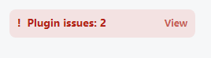
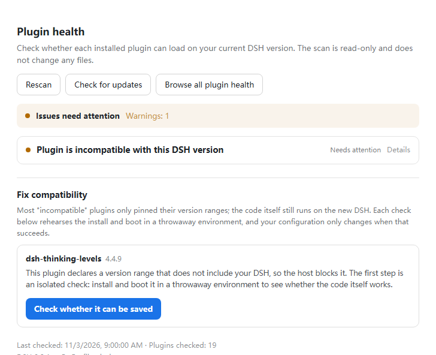
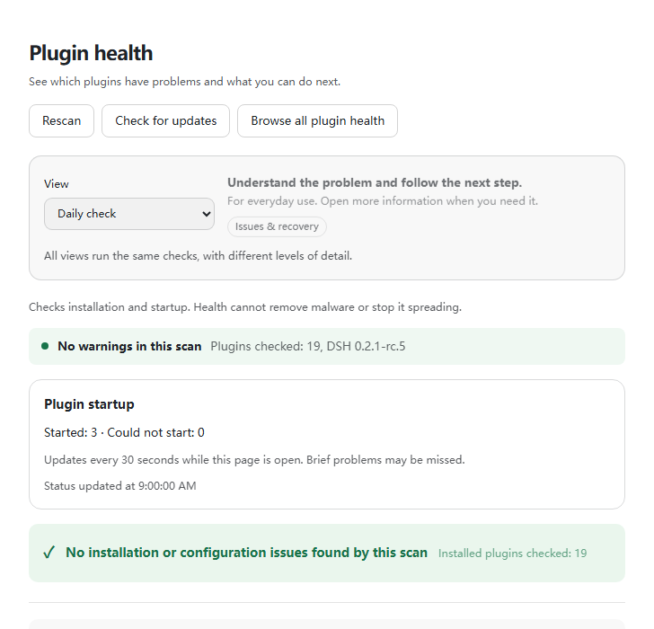

# dsh-plugin-health

[](https://github.com/EasonMWS/dsh-plugin-health/actions/workflows/ci.yml)
[](https://www.npmjs.com/package/dsh-plugin-health)
[](LICENSE)

[English](https://github.com/EasonMWS/dsh-plugin-health/blob/main/README.md) · [中文](https://github.com/EasonMWS/dsh-plugin-health/blob/main/docs/README.zh.md)

**DSH updated and your plugins stopped loading? This tells you which ones broke, which can be fixed,
and which cannot — then fixes them for you.**

Some rejected plugins have outdated version declarations. For trusted plugins, this tool can install
and boot them using a separate temporary DSH data directory before offering a version exemption,
a brief for your own AI, or a configuration change to disable the plugin.

**Health diagnoses compatibility and observed loading problems; it does not contain malware.**
Startup checks execute plugin code with your account permissions and cannot safely open unknown
software. Read [Health's security boundaries](SECURITY.md#malware-containment-is-not-implemented)
and the [official DSH safety notice](https://github.com/deepseek-ai/deepseek-harness/blob/master/SAFETY.md).

> Source candidate: `3.2.0`. The registry install below follows the published npm release.

```sh
npm install -g dsh-plugin-health
```

**No terminal needed.** Install it, restart DSH, then open **Settings → Plugin health** and press the
buttons. The commands below are for people who prefer a shell.

**Not ready to install?** Check any plugin first, in the browser:
**<https://easonmws.github.io/dsh-plugin-health/compat/>** — every catalogued plugin against every
current host version, rebuilt daily.

---

## Contents

| If you are… | Read |
| --- | --- |
| a DSH user whose plugins broke | [Fix a broken plugin](#fix-a-broken-plugin) |
| stuck because DSH will not start | [When DSH will not start](#when-dsh-will-not-start-at-all) |
| a plugin author | [Compatibility checks in CI](#for-plugin-authors-checks-on-every-pull-request) |
| building a plugin market | [Use the plugin index](#use-the-plugin-index-as-a-data-source) |
| checking whether this tool is safe | [Security](#security) |

---

## Fix a broken plugin

When a plugin is rejected, a chip appears in the sidebar — no need to go looking:



Open **Settings → Plugin health**. You get one line per problem, and one button per plugin:

- **Check whether it can be saved** — installs and boots a trusted plugin in a separate temporary
  DSH data directory (30–60 s). Nothing is written to your profile during this step; the executed
  plugin still has your account's access to files, network and processes.
- **If it boots** → *Exempt temporarily*. One entry is written to the host's own
  `compatibility.json`, with one-click undo.
- **If it does not boot** → no exemption button at all. Two honest choices:
  switch the plugin off, or take a prepared brief to your own AI.

You can revoke Health's exemption record. Revocation does not undo effects of plugin execution.



Once the rehearsal passes, you get the exemption and a Revoke button beside it:



**Or check everything at once.** If you prefer a shell:

```
$ dsh-plugin-health doctor --profile desktop
scanned 19 plugins…
✓ 14 healthy
⚠ 3 have a stale version range (these can be saved)
✗ 2 are genuinely incompatible
```

## What "exempt temporarily" actually means

**The gate lets it through — that is not official support.** A passing trial records that startup
checks completed in the temporary DSH data directory. It does not certify plugin safety or all features.

- It writes DSH's own `allow-version` exemption. No plugin is modified, nothing on npm is touched.
- It applies to the host version you granted it for. After an upgrade, it needs re-checking.
- It is listed under "Temporary exemptions". Revoking it restores the recorded exemption value,
  not files, network activity or other effects produced by the plugin.
- Once the author ships a supported release, the panel tells you to revoke and upgrade.

## What happens between "rejected" and "fixed": four layers

Reading declarations is the first layer. Four things happen between a plugin being rejected and your
DSH working again:

| # | Layer | What it does | Where |
| --- | --- | --- | --- |
| **1** | **Detect** | Scans every installed plugin — bundles, `dependencies`, `cordis.patch.yml` inserts (including nested ones) and `node_modules` — and compares each declaration against the version you actually run | your machine |
| **2** | **Verify** | Rehearses a trusted plugin in a **separate temporary DSH data directory**: grants the exemption *there*, installs it, boots it, checks activation | current account; trial files retained |
| **3** | **Repair** | If the rehearsal booted, writes a single official `allow-version` exemption to *your* profile — recorded, one click to undo | your profile |
| **4** | **Escalate** | If the trial fails or is inconclusive, withholds the normal-profile exemption and offers a disable option or a brief for your own agent. Checks upstream for an existing report first | your choice |

**Layer 2 is the one that decides.** Without it, layer 3 would be a guess.

## What layer 1 looks at, beyond version declarations

An incompatible version is the loudest failure and the easiest to explain, but a profile that has been
installed and removed from for months rarely has just that one problem. Layer 1 reads the whole
configuration, not only the ranges:

| What it finds | Why it matters |
| --- | --- |
| **Duplicate insert ids** | Two plugins registering the same entry id. The second one silently replaces the first, and the plugin that lost its entry looks broken for no visible reason |
| **Module replacement** | One plugin's patch removes or replaces a module another plugin provides |
| **Fields dropped by a later layer** | A patch in `home` or `profile` overwrites a field a bundle set, so the bundle's own behaviour changes without any version changing |
| **Host-core packages inside a profile** | A copy of a package the host already ships, which can shadow the host's own |
| **Overlapping shared-write declarations** | Two plugins declaring a write to the same path |

That last row is deliberately called *overlap*, not *conflict*. A declared write to the same file is
evidence of a risk, not proof that two plugins raced — one of them may never run, or may write a
different key. The report says which declarations overlap and which layer each came from, and stops
there. Deciding what to do with that is a judgement about your setup, and the tool does not have it.

## Checking plugins that only fail together

A plugin can boot cleanly on its own and still break when it loads beside its neighbour — they both
want the same tool name, or one needs a service the other replaces. A single-plugin rehearsal cannot
see that.

`smoke` takes repeated `--with <spec>` companions, up to twelve:

```sh
dsh-plugin-health smoke --dsh-dir <installed @deepseek-ai/dsh> \
  --plugin @scope/plugin-a@1.4.0 --boot-only \
  --with @scope/plugin-b@2.0.1 \
  --with @scope/plugin-c@0.9.0
```

The check requires each named package to actually reach `active` in the loader. An entry that merely
shares a name does not count, because that is exactly the failure mode being hunted: something is
registered, so a shallow check reports success while the plugin you asked about never loaded.

This is still a data directory, not a sandbox. See [Safety boundaries](#safety-boundaries-please-read).

## Why that middle layer matters

An outdated version declaration does not tell us whether a plugin will boot. Measured on `0.2.1-rc.4`:

| Plugin | Declared | Observed startup in a temporary DSH data directory |
| --- | --- | --- |
| `@nanmicoder/dsh-agent-teams@0.1.27` | ❌ rejected | ✅ **full boot, all 94 entries active** |
| `dsh-find-plugin@0.4.0` | ❌ rejected | ✅ **runs fine** |
| `@feng0531/dsh-vcs@0.4.10` | ❌ rejected | ❌ **fails: waits for a service the host no longer provides** |

By declaration, all three are equally rejected. Two of them boot without complaint; one does not.
**Reading declarations cannot tell them apart, which is why the trial precedes the normal-profile
exemption.** Exempting the third would have produced exactly the outcome the gate exists to prevent — a
plugin that loads and then misbehaves, with no warning left anywhere.

## For plugin authors: checks on every pull request

**You do not need to install anything for this.** DSH ships a prerelease every week or two, and a
pinned `engines.dsh` breaks your plugin on a schedule. This Action tells you in the PR, before your
users find out.

Add one file, `.github/workflows/dsh-compat.yml`:

```yaml
name: dsh compatibility
on: [pull_request]
permissions:
  contents: read
  pull-requests: write      # required to post the comment
jobs:
  matrix:
    runs-on: ubuntu-latest
    steps:
      - uses: actions/checkout@v4
      - uses: EasonMWS/dsh-plugin-health@v3
        with:
          plugins: .
          versions: latest,next
```

That posts a comment on the PR with a compatibility table, writes a job summary, and uploads
`matrix.json`, `matrix.md` and SVG badges.

**Fail the build when your plugin breaks.** Add `failOn: any` and the job goes red instead of posting
a passing table. Better: watch only the channel you actually support, so a new nightly warns you
without blocking contributors:

```yaml
        with:
          plugins: .
          versions: latest,next,alpha
          failOn: next          # red on the next channel only
```

**Show the result in your README.** The run writes badges you can commit:

```markdown

```

This is the cheapest way to answer "does this still work on the current DSH?" — for you and for
anyone browsing your repo.

**Or a live badge, with nothing to commit.** The public compatibility page publishes a
[shields.io endpoint](https://shields.io/badges/endpoint-badge) for every catalogued plugin, rebuilt daily
against the latest host. Replace `<slug>` with your package name (`@scope/name` becomes `scope__name`):

```markdown
[](https://easonmws.github.io/dsh-plugin-health/compat/#p-<slug>)
```

It says the strongest thing that is true and no more: `boots` only when this exact version was boot-tested
on the latest host, `accepted` when only the declaration was checked, `next build rejects` when your
declaration will refuse the next prerelease, `rejected · boots if exempted` when the declaration is stale
but the code starts. The same data is at `compat/p/<slug>.json`.

Prefer a reusable workflow? [`matrix-review.yml`](.github/workflows/matrix-review.yml) does the same
with less YAML:

```yaml
jobs:
  matrix:
    uses: EasonMWS/dsh-plugin-health/.github/workflows/matrix-review.yml@v3
    with:
      plugins: '.'
      versions: 'latest,next,alpha'
      comment: true
```

Full inputs: [`action.yml`](action.yml) · example: [`examples/dsh-compat.yml`](examples/dsh-compat.yml).

## The flow, in the order it happens

```
scan finds a rejected plugin
  ↓
trial in a temporary DSH data directory: exempt there, then boot trusted code
  ├─ it boots → standalone startup passed in this trial
  │    → confirm, then write one exemption in your profile (undo in one click)
  │    → record it and watch upstream for a real release
  │    → when a fix ships, the record tells you to revoke and upgrade
  └─ it fails or is inconclusive → report what this trial observed
       → do not write the normal-profile exemption
       → two choices: switch it off, or generate a brief for your own agent
```

The order avoids writing a normal-profile exemption before startup checks pass. It does not
constrain the tested code's access to your computer or make an unknown plugin safe to execute.

## What it looks like in Settings

Under **Settings → Plugin health**, every incompatible plugin gets:

- a **"Check whether it can be saved"** button — rehearses install + boot in a temporary DSH data
  directory (30–60 s), before writing a normal-profile exemption;
- **if it boots**: a confirmation step that restates exactly what will be written, that it is
  reversible, and that it is *not* official support — then the exemption;
- **if it does not boot**: no exemption button at all, plus the two honest options;
- every exemption listed with an undo button, flagged once upstream ships a fix.

An exemption is an entry in the host's own `compatibility.json`. Undo restores the recorded
exemption value. It does not reverse plugin side effects or guarantee that loaded code has stopped.

### Three controls in the header

| Control | What it does |
| --- | --- |
| **Rescan** | Re-runs the whole check now |
| **Check for updates** | Asks npm whether *this plugin* is current, on demand |
| **Browse all plugin health** | Opens the [public compatibility table](https://easonmws.github.io/dsh-plugin-health/compat/) in your browser |

**An update installs from the panel — one button, no terminal.** Checking ends in **Update now**,
which runs the profile's own package manager (pnpm in a pnpm profile, never npm into it) against the
exact version the check found. It says it needs a restart rather than performing one: the files change
on disk, the running host keeps the code it loaded, and restarting on your behalf would end your
session without asking. A failure shows the package manager's own message, not an exit code.

**It checks for its own updates when DSH starts, and stays quiet about it.** A health tool that is
itself out of date is worse than useless — it tells you your plugins need attention while missing the
fix released for the checker. One request per launch, at most one every six hours, and it only speaks
up when something newer exists, with the exact upgrade command. An "up to date" banner on every visit
would train you to ignore the strip where a real notice has to appear.

A check that fails is recorded as a failure, never as "you are current": those are different
statements and only one of them is true.

**No outbound traffic from a health tool?** Set `DSH_PLUGIN_HEALTH_NO_UPDATE=1` and it makes no
update requests at all. The panel's **Check for updates** button still works — that one is you asking.

## Check compatibility in a browser

Before installing anything:

**<https://easonmws.github.io/dsh-plugin-health/compat/>**

The compatibility table uses entries from the community catalog and compares their declarations
against current host versions.

| | |
| --- | --- |
| **How many** | All compatibility table entries, including unknown results, with counts by host and a next-build forecast |
| **Category** | The catalog's own category, filterable |
| **Released** | Publish date of the version shown — tells you whether the author is still active |
| **Filter** | By name, by category, or only the rejected ones |
| **Language** | English / 中文, remembered between visits |

A tick means the plugin's declared range admits that host. Startup tests have separate results and
evidence links. Entries marked **GitHub only** use a readable manifest from the default branch.

The same data is downloadable as
[`matrix.json`](https://easonmws.github.io/dsh-plugin-health/compat/matrix.json), and you can build
the page for your own plugin set:

```sh
dsh-plugin-health matrix --plugins list.txt \
  --versions latest,next \
  --catalog https://awesome-dsh-plugin.com/plugins.json \
  --out site/compat
```

## Use the plugin index as a data source

If you are building a plugin market, a directory, or a launcher, there is a ready format-1 index:

```
https://easonmws.github.io/dsh-plugin-health/index.json
```

**Use it in DSH right now:** paste that URL into **Plugins → 自定义插件市场 → 发现 → 添加索引源**.

- **format-1** — the DSH official market index format, validated on every build with
  `@deepseek-ai/dsh-plugin-market-index` (the same reader the DSH host uses)
- **300 plugins**, rebuilt daily at 04:23 UTC
- per plugin: name, description (en + zh), author, repository, homepage, category, download count,
  GitHub stars, a heuristic health score, and the recent version history
- source: [`awesome-dsh-plugin.com/plugins.json`](https://awesome-dsh-plugin.com/plugins.json)

Build your own with:

```sh
dsh-plugin-health index \
  --catalog https://awesome-dsh-plugin.com/plugins.json \
  --host "$(npm view @deepseek-ai/dsh version)" \
  --index-url https://example.com/index.json \
  --limit 300 --out site
```

Details: descriptions are bilingual (`en` required, `zh` kept); categories come from the catalog plus
labels (`npm`, `compatible`, `incompatible`, `unchecked`, `capability risk`) and sort keys
(`downloads`, `stars`, health score). The health score is deterministic — popularity (log downloads
55, log stars 25), then +10 / −20 for whether the declaration admits the host, −10 for a capability
red line, and, when `--verify` supplies a boot test of the exact listed version on the same host, +8 for
`V3` (its entries activated) or −8 for `V1`/`V2` (admitted, but it did not install or start). A plugin that
was never boot-tested neither gains nor loses. Clamped to 0–100. **It is not a security rating.**
Download counts and stars come from public npm and GitHub data.

Scope: npm-published catalog entries only (2,607 of 5,704 in the October 2026 snapshot); GitHub- and
tarball-only entries are skipped and reported.

## Security

**Running anything below 2.1.3? Use the latest 3.x.** Three rounds of review fixed these, and one release fixed
problems the previous one had only half-fixed — so the version matters:

| Version | What it fixed |
| --- | --- |
| **1.1.0** | Seven issues from a security test of 1.0.2, one rated high: the write routes' control key was handed out by the unauthenticated status endpoint |
| **2.0.0** | 25 findings from two more reviews. A cross-origin page could drive every write route (cookies ignore the port, so same-site is not same-origin); a request body could name any package to install and run; three paths granted an exemption without a rehearsal on the target host |
| **2.1.1** | Four fixes from the previous release that did not hold. The worst: the loopback check read only the `Host` header, which the client writes — so with the web server bound to a LAN address, any machine on the network could send `Host: 127.0.0.1:<port>`, pass every check, read the key from `/status`, and disable plugins |
| **2.1.3** | The panel could not obtain its key, so every button answered 401; the message also blamed the network for what was an authentication failure |

**If you bind the DSH web server to a non-loopback address** (`0.0.0.0` or a LAN IP), treat every
plugin route as exposed to the network and check that the host's own authentication is what you are
relying on.

- [GHSA-vj8q-543v-9hw5](https://github.com/EasonMWS/dsh-plugin-health/security/advisories/GHSA-vj8q-543v-9hw5) — 1.1.0
- [GHSA-52w2-cq6j-xhg7](https://github.com/EasonMWS/dsh-plugin-health/security/advisories/GHSA-52w2-cq6j-xhg7) — 2.0.0
- [SECURITY.md](SECURITY.md) — the trust boundary, in full

**Trust boundary, stated plainly:** the write routes are reachable by any local process. The loopback
interface is the boundary — not the control key. A local process can read `Set-Cookie` and replay it;
what the key does stop is a page on another local port, and that is what the peer and same-origin
checks enforce.

## Safety boundaries (please read)

> **Security:** see [Security](#security) above for the full version table. The short version: below
> 2.1.3 you are missing at least one fix that matters, and the loopback check before 2.1.1 could be
> bypassed by a LAN client with a forged `Host` header.

| Health's actions | What Health itself does not do |
| --- | --- |
| Rehearse trusted code using a temporary DSH data directory | ❌ call your AI or spend your tokens |
| Use DSH's official `allow-version` exemption | ❌ modify plugin source or anything on npm |
| Record version exemptions and support revoking them | ❌ grant an exemption when the rehearsal failed |
| Check whether upstream already has a report | ❌ file issues on your behalf |
| Prepare a complete AI brief | ❌ press send for you |

These statements describe Health's own actions. Code executed during a trial has the account's
permissions and is outside these guarantees. A failed trial can already have produced side effects.
Health's repair quarantine is an ordinary backup directory, not antivirus isolation.

**A temporary exemption allows loading on the selected host version.** The trial covers observed
startup checks, not malicious behavior or all features. When the author ships a supported version,
revoke the exemption and upgrade. Revoking permission does not undo plugin effects.

## What 3.x promises

A major version is a promise about stability, so here is exactly what is frozen and what is not —
rather than letting you find out by upgrading.

2.0.0 broke three things on purpose, and they are listed in the changelog: writes need
`application/json`, the rescue actions refuse plugins that are not installed, and a
`compatibility.json` that cannot be parsed is refused rather than rewritten. Everything below has
held since 1.0 and still holds.

**Frozen** for 3.x:

| Surface | Guarantee |
| --- | --- |
| CLI commands and flags (`matrix`, `smoke`, `doctor`, `repair`, `rescue`, `handoff`, `report`, `boot`, `index`) | Existing flags keep their meaning. New flags may be added; none are removed or repurposed |
| The `plugin_health` agent tool's name and input schema | Additive fields only |
| Exit codes (`0` success, `1` findings/failure, `2` usage error) | Unchanged |
| Files this tool writes (`compatibility.json`, `plugin-health-rescue.json`, handoff bundles) | Format documented and forward-compatible: unknown keys are preserved, never dropped |
| The status route shape (`/plugins/dsh-plugin-health/status`) | Fields may be added; existing fields keep their names and types. Since 2.1.3 the body also carries `key`, the per-launch control key the panel uses to authenticate its own writes — see [Security](#security) for why that is not a weaker boundary than the cookie |

**Not frozen** — may change in a minor release, because they are presentation or internals:

- UI wording, layout, colours and the structure of the settings panel;
- the recommendation text inside generated AI briefs and issue drafts;
- internal module layout under `src/` (nothing in `src/` is a public import path except
  `./api` and `./client`);
- the set of finding ids beyond the documented ones — new checks will introduce new ids.

**Version policy for a host bump.** `engines.dsh` is a range (`>=0.2.0-rc.0 <0.3.0-0`), not an
enumeration, so a new DSH nightly does not break this plugin the way it breaks plugins that pin
exact versions. When DSH 0.3.0 ships, this package needs a release that extends that range — the one
known expiry point, announced in the changelog before it lands.

## When DSH will not start at all

If a plugin stops DSH from booting, the settings page cannot help — it runs inside DSH. These three
commands run **entirely outside the host**, so they still work from a terminal:

```sh
# 1. Why did it fail? Reads the host's own crash reports, then static checks.
dsh-plugin-health boot diagnose --profile desktop

# 2. Cannot tell? Disable every third-party entry so DSH starts again.
dsh-plugin-health boot safe --profile desktop --apply

# 3. Once the culprit is fixed, put everything back.
dsh-plugin-health boot restore --profile desktop --apply
```

`boot diagnose` reads the desktop app's crash reports
(`%APPDATA%\@deepseek-ai\dsh-desktop\logs\crash-*.log`), which name the offending package outright
when a plugin is at fault — the CLI itself prints to stderr and leaves nothing on disk.

`boot safe` only appends `disabled: true` overlays to the profile's own patch layer: **no files are
deleted, no plugin is modified, host entries are never touched, and this tool never disables
itself** (that would remove the panel explaining what happened). `boot restore` removes only the
entries it added, leaving your own patches exactly as they were. Both default to a dry run; add
`--apply` to write.

## Looking for a plugin manager / doctor / checker?

This package is what you want if you are searching for any of these:

| If you are looking for… | This package does that |
| --- | --- |
| a **plugin manager** for DSH | shows every installed plugin and its state in one page |
| a **plugin checker / inspector / scanner** | scans all installed plugins, not a sample |
| a **plugin doctor** / diagnostics | explains what is broken and what to do about it |
| Plugin upgrade and conflict review | checks declared DSH ranges, literal patch overrides and declared shared writes |
| to **fix / repair a broken plugin** | one-click repair (quarantine only, never deletes) |
| why a plugin **stopped working after a DSH update** | compares declared ranges against the new host |
| 插件管理 / 插件检查 / 插件冲突 / 插件诊断 / 插件不兼容 | 中文界面，设置 → 插件健康 |

Not this package if you want to *browse and install new plugins from a market* — that is a
marketplace, while this one manages what you already have. (It does build the official format-1
index that marketplaces can consume.)

## Why this exists: after an upgrade, DSH drops a plugin with one line on stderr

DSH rejects a *new* install whose declared range does not cover the running version:

```
$ dsh plugin --profile test add dsh-session-recall
dsh: installation rejected: Plugin dsh-session-recall@0.7.9 is incompatible with dsh 0.2.1-rc.3
dsh: nothing was installed.
```

It also re-checks plugins that are already installed, every time a profile starts. A bundle whose
declaration no longer admits the host is skipped, and the rest of the profile starts as if nothing happened.
All it leaves behind is a line on stderr, which the desktop app does not show:

```
dsh: skipping profile bundle "dsh-browser-cdp": Error: Plugin dsh-browser-cdp@1.7.5 is incompatible
with dsh 0.2.2-rc.1: requirements {"engines.dsh":"0.1.7-rc.1 || … || 0.2.1-rc.5"}. …
```

Verified on 2026-11-09 against `@deepseek-ai/dsh-app-boot` from `0.2.0-rc.2` through `0.2.2-rc.1` (the
check is in `loadProfileDirectory`, and entries from patch layers are disabled by the startup preflight), and
by booting a profile with that plugin installed: with its exemption it registers its tool; without it the
profile boots with the plugin silently absent. Earlier versions of this README said the plugin "keeps
loading" after an upgrade — that was wrong.

So a plugin you rely on can vanish after a host update, with nothing in the UI to say which one or why.
That is the gap this package fills: it reads what every installed plugin declares, compares it against the
version you are actually running, tells you which ones the host is now dropping, and checks whether each
one would still start.

## It has already caught real regressions

Each time the host moves, the same scan runs across catalogued plugins, and every maintainer whose
plugin the new host rejects gets a report: which declaration fails, on which host version, and what
the official evaluator says. A maintainer can confirm it without installing anything.

As of 2026-11-09: **11 reports filed, 10 fixed and released by their maintainers, 1 still without a
reply.** Most were closed within two days.

| Host | Plugin | Report | Fixed in |
| --- | --- | --- | --- |
| `0.2.1-rc.2` | `dsh-plugin-subscriptions` | [V1ki/dsh-plugin-subscriptions#158](https://github.com/V1ki/dsh-plugin-subscriptions/issues/158) | `0.9.10` |
| `0.2.1-rc.3` | `@anionex/dsh-vision-toolkit` | [Anionex/dsh-vision-toolkit#178](https://github.com/Anionex/dsh-vision-toolkit/issues/178) | `0.1.48` |
| `0.2.1-rc.3` | `@nanmicoder/dsh-agent-teams` | [NanmiCoder/dsh-agent-teams#277](https://github.com/NanmiCoder/dsh-agent-teams/issues/277) | `0.1.27` |
| `0.2.1-rc.3` | `@goodandready/dsh-clinebot` | [GooDAnDReaDY/dsh-clinebot#17](https://github.com/GooDAnDReaDY/dsh-clinebot/issues/17) | `0.6.16` |
| `0.2.1-rc.5` | `dsh-chat-manager` | [WSL043/dsh-chat-manager#35](https://github.com/WSL043/dsh-chat-manager/issues/35) | `1.5.21` |
| `0.2.1-rc.5` | `dsh-context-compression-improved` | [drscrewdriver/dsh-context-compression-improved#9](https://github.com/drscrewdriver/dsh-context-compression-improved/issues/9) | `0.10.3` |
| `0.2.1-rc.5` | `dsh-prime-memory` | [drscrewdriver/dsh-prime-memory#26](https://github.com/drscrewdriver/dsh-prime-memory/issues/26) | `0.26.16` |
| `0.2.1-rc.5` | `dsh-perm-gate` | [drscrewdriver/dsh-perm-gate#5](https://github.com/drscrewdriver/dsh-perm-gate/issues/5) | `5.4.1` |
| `0.2.1-rc.5` | `dsh-browser-cdp` | [drscrewdriver/dsh-browser-cdp#7](https://github.com/drscrewdriver/dsh-browser-cdp/issues/7) | `1.7.5` |
| `0.2.1-rc.5` | `dsh-thinking-levels` | [drscrewdriver/dsh-thinking-levels#7](https://github.com/drscrewdriver/dsh-thinking-levels/issues/7) | `4.4.10` |
| `0.2.1-rc.2` | `@feng0531/dsh-vcs` | [f-e-n-g-0531/dsh-vcs#1](https://github.com/f-e-n-g-0531/dsh-vcs/issues/1) | — no reply yet |

One more, `dsh-workbuddy-connect`, was rejected on `0.2.1-rc.3`, but its repository is unreachable,
so no report could be filed.

> Confirmed against the published 0.1.47 manifest and the official rc.3 host compatibility
> evaluator: **19 DSH peers were rejected**, while rc.2 still passed.
> Fixed on main in #179 … All nine PR CI jobs passed, including the **new required rc.3 Profile
> lane**.
>
> — [Anionex/dsh-vision-toolkit#178](https://github.com/Anionex/dsh-vision-toolkit/issues/178#issuecomment-6388178989)

How to declare the range stays the maintainer's call. Some added the one new version they had tested;
two switched to a range that covers the rest of the prerelease line
(`dsh-clinebot` in `0.6.16`, `dsh-plugin-subscriptions` in `0.9.12`), so the next prerelease on that
line will not reject them again.

Upgrade reports: [docs/upgrade-0.2.1.md](docs/upgrade-0.2.1.md) ·
[docs/upgrade-0.2.1-rc3.md](docs/upgrade-0.2.1-rc3.md).
Listed in [awesome-dsh-plugin](https://github.com/awesome-dsh-plugin/awesome-dsh-plugin) and on
[dsh-plugin.org](https://dsh-plugin.org).

## A real UI, only when you need it

Install it as a bundle and DSH gets a native **Settings → Plugin health** section
(**设置 → 插件健康** in Chinese). The panel and sidebar alert follow DSH's language setting,
including finding details and repair confirmations.

```sh
dsh plugin --profile desktop add dsh-plugin-health
#                 ^^^^^^^ desktop app uses `desktop`; `dsh web` uses `web`
```

- **Installation scan** counts packages found in the current setup through bundles, dependencies,
  patch entries and plugin-like directories. Missing or damaged packages can be part of that count.
  **Startup status** counts loader entries. One package can contribute multiple entries.
- Every finding is written in plain language with a concrete next step — a first-time user can act
  without reading CLI docs.
- The first status line says **No issues found in this scan** or **Issues need attention**.
  Choose **Rescan** to run the check again, **Check for updates** to check Health itself, or
  **Community compatibility** to see public table entries. [Public compatibility table](https://easonmws.github.io/dsh-plugin-health/compat/)
- **It checks for its own updates when DSH opens** and only speaks up when there is something newer,
  with the exact upgrade command. No "you are up to date" banner on every visit.
- The sidebar shows an entry when issues or an available Health update need attention.
- **When something is wrong**, a compact `插件有 N 个问题` entry appears above the account menu and
  jumps straight to the section.
- The host half only serves a loopback-only read-only snapshot; the plugin never modifies your
  profile.

> **Upgrading DSH? Run the check first.**
>
> `0.2.1-rc.3` (2026-10-23) dropped the compatible count from 118 to **113 of the top 120** plugins:
> **5 plugins that worked on rc.2 stop loading on rc.3**, all because they enumerate exact
> `@deepseek-ai/*` versions. As of 2026-10-26, **4 of them have shipped fixes** (affected 5 → 1).
> Earlier, rc.2 had broken 3 others. Latest report:
> [docs/upgrade-0.2.1-rc3.md](docs/upgrade-0.2.1-rc3.md) ·
> [docs/upgrade-0.2.1.md](docs/upgrade-0.2.1.md).
>
> ```sh
> dsh-plugin-health matrix --plugins plugins.txt --versions 0.2.1-rc.2,0.2.1-rc.3
> ```

## Why

DSH ships no official plugin market index and publishes a prerelease roughly every two days with
breaking changes. Its official plugin manager does install, list versions, update and grant version
exemptions — but it judges a plugin against the host that is running, so an author still has to check
a plugin against every other version by hand, and nothing verifies that a plugin actually starts.
Windows/WSL install failures also leave partial directories and stale locks behind.

This tool covers the three gaps that the existing doctor/market tools do not:

1. **Multi-host compatibility matrix** — will a plugin load on `0.1.7-rc.2`, `0.2.0-rc.2`,
   `0.2.1-alpha.4`, `0.2.1-rc.2`, ...? Evaluated with the exact official semantics
   (`engines.dsh` first, otherwise `@deepseek-ai/dsh*` peers, prereleases included,
   `workspace:` ranges mapped to the host version).
2. **Official format-1 market index** — turn a community catalog into a JSON index that the
   built-in DSH **Discover** tab accepts, validated by the same parser the DSH Host uses.
3. **Windows/WSL install doctor** — read-only by default; repairs quarantine, never delete, and
   patch edits keep the user's comments.

## Install

```sh
npm install -g dsh-plugin-health
# or run the checkout:
git clone https://github.com/EasonMWS/dsh-plugin-health.git && cd dsh-plugin-health && npm ci
node bin/dsh-plugin-health.js --help
```

Requires Node.js 20+.

### Install inside DSH (bundle mode)

The package is also an installable DSH bundle. Installing it into a profile adds a read-only
`plugin_health` agent tool that reports missing third-party bundles, broken package directories,
`cordis.patch.yml` residue, proxy/registry configuration, profile drift, and installed plugins
incompatible with the running DSH version.

```sh
dsh plugin --profile desktop add dsh-plugin-health
#                 ^^^^^^^ desktop app uses `desktop`; `dsh web` uses `web`
```

The bundle declares `engines.dsh` and registers this read-only tool alongside the settings UI.
Profile changes use the UI's explicit repair and exemption controls; startup can also check for
Health updates as described above.

## 1. Compatibility matrix

```sh
dsh-plugin-health matrix \
  --plugins examples/plugins.txt \
  --versions latest,next,alpha,0.1.7-rc.2 \
  --out dsh-health-out/matrix \
  --fail-on any
```

- `--plugins` accepts a file (one spec per line, `#` comments allowed), a comma list, or repeated
  flags. A spec is `name`, `name@version`, or a local plugin directory.
- `--versions` accepts exact SemVer versions or npm dist-tags of `@deepseek-ai/dsh`
  (`latest`, `next`, `alpha`, ...).
- Output: `matrix.json`, `matrix.md`, and static SVG badges (`badges/`).
- `--fail-on any|none|<host>` makes the command usable as a CI gate.

The evaluation mirrors `packages/boot/app-boot/src/plugin-compatibility.ts`:

| Manifest declares | Check |
|---|---|
| `engines.dsh` | that range alone; peers are ignored |
| no `engines.dsh`, has peers | every `@deepseek-ai/dsh` / `@deepseek-ai/dsh-*` peer range |
| peer range `workspace:^` / `~` / `*` | the running host version |
| prerelease host versions | participate in ranges (`includePrerelease: true`) |

The matrix is **static** (manifests + official requirements). A passing declaration does not
prove that a plugin activates or that its tools work. Use the separate opt-in `smoke` command
below for runtime acceptance. Git-only plugins can be checked statically from a local clone.

### Runtime acceptance in a fresh profile

Install the host version you want to test into a separate directory, then test the package users
will install, including a release tarball:

```sh
npm install --prefix /tmp/dsh-rc3 @deepseek-ai/dsh@0.2.1-rc.3
dsh-plugin-health smoke \
  --dsh-dir /tmp/dsh-rc3/node_modules/@deepseek-ai/dsh \
  --plugin ./my-plugin-1.0.0.tgz \
  --tool my_plugin_tool \
  --calls ./smoke-calls.json \
  --out dsh-health-out/runtime
```

`smoke-calls.json` is an array of tool calls. Each call must complete without a tool error;
`expectedValue`, when provided, is compared with the entire structured return value:

```json
[{"name":"my_plugin_tool","arguments":{"input":"example"},"expectedValue":{"answer":42}}]
```

The command installs through the official `dsh plugin` CLI into a new `DSH_HOME`, boots through
the host's public `@deepseek-ai/dsh/profile-boot` export, checks named tool registrations, executes
the supplied calls, and disposes the profile. It requires at least one `--tool` or `--calls`
assertion. `--tool` alone checks registration, not tool behavior or browser rendering.

Installation has a 120-second limit. Boot, calls and shutdown share a 30-second limit; override
with `--install-timeout` and `--timeout` (milliseconds). On timeout, Health attempts to stop the
trial's child process tree; cleanup is best effort. The report names the failing
stage (`install`, `boot`, `assertions` or `shutdown`) and preserves the host diagnostic. Exit 1
means acceptance failed, even if a signal handler exits zero after a timeout.
On POSIX, a process that exits zero but leaves background descendants also fails acceptance and
its remaining process group is stopped. Windows uses `taskkill /T` for timeouts; detecting children
after their parent has already exited is not supported there.

**The plugin under test inherits your environment by default.** That is the documented behaviour when
you rehearse your own plugin: it is your code, running with your permissions. When the plugin is one you have
not read — a batch run, a CI job over a catalog — pass `--clean-env` and only a fixed list crosses the
boundary: the machine basics (`PATH`, `HOME`, `TMPDIR`, locale, `TZ`, `CI`, the Windows equivalents),
the package-manager plumbing (`HTTP_PROXY`, `HTTPS_PROXY`, `NO_PROXY`, `NODE_EXTRA_CA_CERTS`,
`npm_config_*`, `PNPM_HOME`, the XDG directories), and `DSH_HOME`. Anything whose name looks like a
credential is refused even if it would otherwise be allowed, and CI-injected `ACTIONS_*`, `GITHUB_*` and
`RUNNER_*` variables never pass. The report records `env: { mode, passed }` — names only, never values.

A proxy URL that carries a username and password is still passed, because the install cannot reach the
registry without it. `--clean-env` narrows what the plugin can see; it is not a sandbox.

Every run retains its home, `smoke.json`, `runtime.json` and bounded stdout/stderr in a new run
directory. Health selects that new directory as the trial's profile; it does not prevent the tested
code from accessing existing profiles. There is no automatic cleanup; inspect logs before sharing
them. Repeat with a separate installed host directory for each version in your matrix.
The installed host needs Node.js and pnpm versions supported by that DSH release, and must export
`profile-boot` (tested with `0.2.1-rc.2` and `0.2.1-rc.3`).

**This runs plugin code with your OS account permissions and inherited environment.** A temporary
DSH home selects separate test data; it does not restrict file, network or process access. Only run
packages you trust. Unknown software needs a separately configured environment that restricts files,
credentials, networking and processes; Health does not create or verify that environment. Startup
checks cannot certify all plugin behavior, safety or UI compatibility.

### Verify many plugins at once

`verify` runs the boot-only smoke for a list of plugins, always with `--clean-env`, and gives each a level:

| Level | Meaning |
| --- | --- |
| `V1` | its declaration admits this host (the same evaluation the install gate runs) |
| `V2` | the official CLI installed it into a clean profile |
| `V3` | after boot, every entry of the plugin is active |

```sh
dsh-plugin-health verify --dsh-dir <installed @deepseek-ai/dsh> \
  --plugins plugins.txt --out verify-out [--cache .verify-cache] [--shard 3/10] [--concurrency 2]
```

A plugin whose declaration rejects the host is still run once with the exact-version exemption inside the
throwaway home, and the result is recorded under `bypass`. It never raises the level: "the declaration is
stale but the code boots" and "the code is broken" are different findings, and the page shows both.

Each plugin's footprint (entries and tool names) is recorded relative to an empty profile on the same host,
so it lists only what the plugin added. Two plugins that add the same tool name or entry id are listed in
`conflicts` as **predicted** — they were not installed together.

Output: `verify.json` (levels, failure kinds, predicted conflicts) and `results/<slug>.json` (the full
smoke report with package integrity, tool and runtime versions, and stage timings). `--cache` reuses a
result for the same package bytes, host and tool line. Exit code is `0` when the run completes;
`--fail-on any` returns `1` if any plugin stops short of `V3`.

`V3` means the plugin started. It is not a review of what the code does, and it does not cover features that
need an API key, the desktop app, or a working UI.

### Example run (2026-10-17, 7 plugins × 4 hosts)

```
dsh 0.1.7-rc.2: 6/7 compatible, 1 incompatible
dsh 0.2.0-rc.2: 5/7 compatible, 2 incompatible
dsh 0.2.1-alpha.4: 5/7 compatible, 2 incompatible
dsh 0.2.1-rc.2: 5/7 compatible, 2 incompatible
✗ dsh-win32@0.17.14: incompatible on all four (narrow @deepseek-ai/dsh-subprocess-local peers)
✗ dsh-find-plugin@0.4.0: incompatible from 0.2.0-rc.2 (@deepseek-ai/dsh-tools peer)
```

The first result reproduces the real failure tracked in `dsh-win32` issue #89 (a peer upper bound
that is too narrow for later host lines) without installing anything.

## 2. Windows/WSL doctor and repair

```sh
dsh-plugin-health doctor --home C:\Users\me\.dsh --profile desktop --runtime 0.2.1-rc.2
dsh-plugin-health repair --home C:\Users\me\.dsh --profile desktop --apply --yes
```

Checks: declared third-party bundles that are not installed (bundles shipped by the DSH
installation are treated as provided), unreadable/partial package directories, missing profile
dependencies, broken or empty `cordis.patch.yml` entries, `.bak-*` / `.lock` / `.lock.takeover-*`
residue, large plugin-manager logs, WSL and long Windows paths, installed-plugin incompatibility
against `--runtime`, and plugin-set drift between profiles.

Repairs are opt-in (`--apply`), default to a dry run, and never delete:

- files/directories move to `<home>/.plugin-health/quarantine/<timestamp>/` (a `repair-log.json`
  records every action);
- `cordis.patch.yml` is edited textually (top-level `- []` entries only) after a backup, so comments
  and formatting survive.

## Review your profile before making changes

Open **Settings → Plugin health** and use the buttons next to the title. **Daily** shows findings and
recovery controls, **Advanced** adds loader entries and configuration findings, and **Developer**
adds runtime evidence export and CLI examples. The upgrade preview reports how many packages had
assessable version declarations and how many had mismatches without exemptions.

Tab to a view button and use Enter or Space to select it. Preview inputs, results and expanded sections
are preserved when switching views. Hover over or focus **Rescan** for refresh timing and the last
observed startup state timestamp. The footer describes the security limits. A failed refresh preserves
the last results with a stale notice, and a later configuration
change prompts a new preview. Review exported plugin names, configuration identifiers and paths before sharing.
Read requests time out after 15 seconds and allow retry. Repair confirmation uses a one-use preview
valid for five minutes. New or changed targets require another preview; failed repairs show their reason
and offer a fresh plan before confirmation.

`scripts/browser-qa.mjs` exercises the real React component in Edge using synthetic host responses,
including three views, keyboard interaction, transitions, downloads, 360px layouts and dark appearance.
Its setup instructions keep test dependencies outside the package. Native DSH desktop acceptance is separate.

The status endpoint samples the current loader as the panel or sidebar refreshes. It records the last
24 observed transitions in memory for this host session. If the host retains a recognized duplicate-tool
error, the panel shows the tool name and the rejected entry. This is a sampled view of activation.
Tool execution, file writes and network access require a separate test.

The downloadable snapshot can be compared from a terminal, including when DSH cannot start.

```sh
dsh-plugin-health review --profile desktop --runtime 0.2.1-rc.5 --save before.json
dsh-plugin-health review --profile desktop --target 0.2.1-rc.6 --candidate ./unpacked-plugin --json
dsh-plugin-health review --profile desktop --runtime 0.2.1-rc.6 --compare before.json
```

The candidate command reads an unpacked local package without installing or starting it. It models
the bundle's declared patch in the current order, or at the end of the bundle list for a new install.
The report separates declarations from loader state. It identifies repeated literal insert IDs,
configuration keys omitted by later rows and selected core package copies inside the profile.
It leaves dynamic patch rows, launcher overlays and actual tool or file behavior unverified.
The snapshot stores package metadata and file fingerprints. It is a comparison baseline, and repair
backups are stored separately. Exit status 1 indicates a known declaration mismatch or a command error.
For CI, retain the JSON report alongside the existing runtime acceptance checks.

To test trusted packages together, repeat `--with <name@version|unpacked-dir>` on a
`smoke --dsh-dir <dir> --plugin <name@version|unpacked-dir>` command with `--boot-only` or
your existing tool assertions. The trial installs the selected packages in one temporary profile,
checks that each enters the loader, and records each install separately. The same OS permission
boundary as the single-plugin trial applies.

Plugin authors can optionally declare exact file access in `package.json`:

```json
{
  "dshPluginHealth": {
    "version": 1,
    "resources": [
      { "scope": "workspace", "path": "archive/index.json", "access": "write" }
    ]
  }
}
```

Scopes are `workspace`, `profile` and `dsh-home`. Entries are relative file names with `read` or `write`
access. Review flags multiple declared writers to the same scoped file, including a local candidate.
This is evidence of declared intent and requires cooperation from plugin authors.

For new repairs using the default quarantine, the repair output includes a run ID.
`dsh-plugin-health repair --restore <run-id>` previews recovery. Add `--apply --yes` to restore
eligible items. Recovery refuses to overwrite an occupied quarantine destination or a patch edited
after repair. Start DSH afterward to verify the affected behavior.

## What shipped, in the order it landed

Everything this section used to list as future work is in the package:

| Capability | How to use it |
| --- | --- |
| Runtime acceptance for browser-only plugins | `smoke --boot-only` accepts activation alone, without probing agent tools |
| Git and tarball sources, not just registry specs | `smoke --plugin <spec|tarball>` |
| A matrix over the whole catalog, built nightly | `.github/workflows/publish-index.yml`, published beside the index |
| An in-app panel for the matrix and doctor results | Settings → Plugin health, in three view modes |
| A reusable GitHub Action and a public dashboard | `action.yml`, and [the compatibility page](https://easonmws.github.io/dsh-plugin-health/compat/) |

## Development

```sh
npm ci
npm test
```

Unit tests cover the official compatibility semantics, the format-1 builder (validated with the
official parser), doctor/repair fixtures, and runtime-runner failure paths. `npm test` needs no
network. To run the separate installed-host acceptance fixtures (requires pnpm and an installed
host):

```sh
npm run test:runtime -- /tmp/dsh-rc3/node_modules/@deepseek-ai/dsh
```

This packs and installs controlled healthy, pending-injection, throwing-init and hanging-init
fixtures. Their profiles and reports are retained for inspection.

## Disclaimer

DSH plugins run with the user's full permission. A health score, a compatibility label, or a
catalog listing is not a security review. Third-party indexes are unsigned; only add sources you
trust.

## License

MIT
