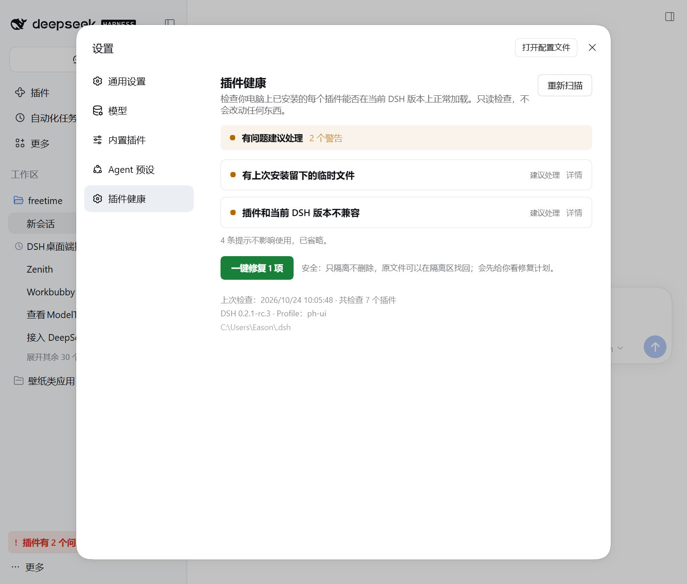
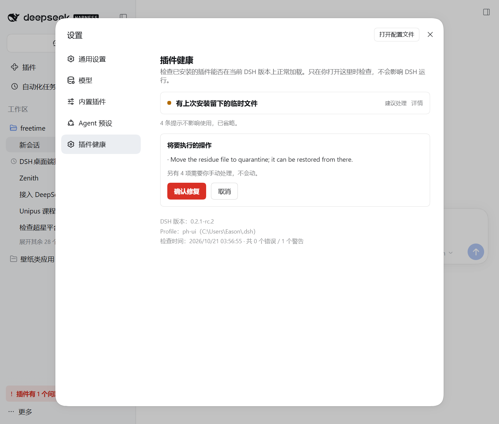

# dsh-plugin-health

[](https://github.com/EasonMWS/dsh-plugin-health/actions/workflows/ci.yml)
[](https://www.npmjs.com/package/dsh-plugin-health)
[](LICENSE)

**The only DSH plugin checker that repairs what it finds — and proves the repair works before
touching your configuration.**

Every other tool stops at *"this plugin is incompatible."* This one answers the next question:
*can it be saved, and how?* It rehearses the plugin in a throwaway home, boots it for real, and
only then decides whether to repair, to hand you a brief for your own agent, or to switch the
plugin off so DSH keeps working.

> Status: `1.0.2`. Built against the official DSH `0.2.1-rc.2` compatibility rules and the
> published `@deepseek-ai/dsh-plugin-market-index` validator.

**Live official format-1 index:** <https://easonmws.github.io/dsh-plugin-health/index.json>
(300 plugins, rebuilt nightly) · **npm:** `npm install -g dsh-plugin-health` ·
**repo:** <https://github.com/EasonMWS/dsh-plugin-health>

Listed on the [awesome-dsh-plugin](https://awesome-dsh-plugin.com/zh/p/EasonMWS/dsh-plugin-health/)
directory and the [DSH Plugin Store](https://www.dshplugin.store/plugin/EasonMWS/dsh-plugin-health).

## What makes this different: four layers, not one

A static checker reads declarations. That is layer one of four — and on its own it is wrong often
enough to be dangerous. Here is the whole path, and where each layer runs:

| # | Layer | What it does | Where |
| --- | --- | --- | --- |
| **1** | **Detect** | Scans every installed plugin — bundles, `dependencies`, `cordis.patch.yml` inserts (including nested ones) and `node_modules` — and compares each declaration against the version you actually run | your machine |
| **2** | **Verify** | Rehearses the rejected plugin in a **throwaway DSH home**: grants the exemption *there*, installs it, boots it, checks every entry activated | isolated, disposable |
| **3** | **Repair** | If the rehearsal booted, writes a single official `allow-version` exemption to *your* profile — recorded, one click to undo | your profile |
| **4** | **Escalate** | If it did not boot, changes nothing and offers two real decisions: switch the plugin off, or take a prepared brief to your own agent. Checks upstream for an existing report first | your choice |

**Layer 2 is the reason this exists.** Without it, layer 3 is a guess.

## Why that middle layer matters

Most rejected plugins have perfectly good code — the author pinned exact versions and has not
caught up with the new host. Measured on `0.2.1-rc.4`:

| Plugin | Declared | Actually boots in isolation |
| --- | --- | --- |
| `@nanmicoder/dsh-agent-teams@0.1.27` | ❌ rejected | ✅ **full boot, all 94 entries active** |
| `dsh-find-plugin@0.4.0` | ❌ rejected | ✅ **runs fine** |
| `@feng0531/dsh-vcs@0.4.10` | ❌ rejected | ❌ **fails: waits for a service the host no longer provides** |

The first two are false alarms a static checker would report as broken. **The third is why the
rehearsal must exist**: exempting it would have produced exactly the outcome the gate was trying to
prevent — a plugin that loads and then misbehaves, with no warning left anywhere.

## The flow, in the order it happens

```
scan finds a rejected plugin
  ↓
rehearse in a throwaway home: exempt the gate, then really boot it   ← your profile is untouched
  ├─ it boots → the code is fine, only the declaration is stale
  │    → confirm, then write one exemption in your profile (undo in one click)
  │    → record it and watch upstream for a real release
  │    → when a fix ships, the record tells you to revoke and upgrade
  └─ it fails → genuinely incompatible; exempting it would not help
       → change nothing, say so plainly
       → two choices: switch it off, or generate a brief for your own agent
```

**The order is the safety property.** Exempt-then-test leaves you running a plugin the gate no
longer warns about but which still crashes. We prove it boots in isolation before your
configuration changes.

## What it looks like in Settings

Under **Settings → Plugin health**, every incompatible plugin gets:

- a **"Check whether it can be saved"** button — rehearses install + boot in a throwaway home
  (30–60 s), changing nothing;
- **if it boots**: a confirmation step that restates exactly what will be written, that it is
  reversible, and that it is *not* official support — then the exemption;
- **if it does not boot**: no exemption button at all, plus the two honest options;
- every exemption listed with an undo button, flagged once upstream ships a fix.

Everything is reversible: an exemption is a single entry in the host's own `compatibility.json`,
and undo restores exactly the value that was there before.

## Safety boundaries (please read)

| We do | We never do |
| --- | --- |
| Rehearse in an isolated temporary home | ❌ call your AI or spend your tokens |
| Use DSH's official `allow-version` exemption | ❌ modify plugin source or anything on npm |
| Record every change and support exact undo | ❌ grant an exemption when the rehearsal failed |
| Check whether upstream already has a report | ❌ file issues on your behalf |
| Prepare a complete AI brief | ❌ press send for you |

**A temporary exemption means the gate lets it through — not that it is supported.** We only prove
it boots in isolation; whether every feature works is still on you to observe. When the author ships
an official version, revoke the exemption and upgrade.

## What 1.0 promises

A major version is a promise about stability, so here is exactly what is frozen and what is not —
rather than letting you find out by upgrading.

**Frozen** — these will not break within 1.x:

| Surface | Guarantee |
| --- | --- |
| CLI commands and flags (`matrix`, `smoke`, `doctor`, `repair`, `rescue`, `handoff`, `report`, `boot`, `index`) | Existing flags keep their meaning. New flags may be added; none are removed or repurposed |
| The `plugin_health` agent tool's name and input schema | Additive fields only |
| Exit codes (`0` success, `1` findings/failure, `2` usage error) | Unchanged |
| Files this tool writes (`compatibility.json`, `plugin-health-rescue.json`, handoff bundles) | Format documented and forward-compatible: unknown keys are preserved, never dropped |
| The status route shape (`/plugins/dsh-plugin-health/status`) | Fields may be added; existing fields keep their names and types |

**Not frozen** — may change in a minor release, because they are presentation or internals:

- UI wording, layout, colours and the structure of the settings panel;
- the recommendation text inside generated AI briefs and issue drafts;
- internal module layout under `src/` (nothing in `src/` is a public import path except
  `./api` and `./client`);
- the set of finding ids beyond the documented ones — new checks will introduce new ids.

**Version policy for a host bump.** `engines.dsh` is a range (`>=0.1.0-rc.6 <0.3.0-0`), not an
enumeration, so a new DSH nightly does not break this plugin the way it breaks plugins that pin
exact versions. When DSH 0.3.0 ships, this package needs a release that extends that range — the one
known expiry point, announced in the changelog before it lands.

## When DSH will not start at all

If a plugin stops DSH from booting, the settings page cannot help — it runs inside DSH. These three
commands run **entirely outside the host**, so they still work from a terminal:

```sh
# 1. Why did it fail? Reads the host's own crash reports, then static checks.
dsh-plugin-health boot diagnose --profile desktop

# 2. Cannot tell? Disable every third-party entry so DSH starts again.
dsh-plugin-health boot safe --profile desktop --apply

# 3. Once the culprit is fixed, put everything back.
dsh-plugin-health boot restore --profile desktop --apply
```

`boot diagnose` reads the desktop app's crash reports
(`%APPDATA%\@deepseek-ai\dsh-desktop\logs\crash-*.log`), which name the offending package outright
when a plugin is at fault — the CLI itself prints to stderr and leaves nothing on disk.

`boot safe` only appends `disabled: true` overlays to the profile's own patch layer: **no files are
deleted, no plugin is modified, host entries are never touched, and this tool never disables
itself** (that would remove the panel explaining what happened). `boot restore` removes only the
entries it added, leaving your own patches exactly as they were. Both default to a dry run; add
`--apply` to write.

## Looking for a plugin manager / doctor / checker?

This package is what you want if you are searching for any of these:

| If you are looking for… | This package does that |
| --- | --- |
| a **plugin manager** for DSH | shows every installed plugin and its state in one page |
| a **plugin checker / inspector / scanner** | scans all installed plugins, not a sample |
| a **plugin doctor** / diagnostics | explains what is broken and what to do about it |
| **plugin conflict** detection | flags plugins that will not load on your DSH version |
| to **fix / repair a broken plugin** | one-click repair (quarantine only, never deletes) |
| why a plugin **stopped working after a DSH update** | compares declared ranges against the new host |
| 插件管理 / 插件检查 / 插件冲突 / 插件诊断 / 插件不兼容 | 中文界面，设置 → 插件健康 |

Not this package if you want to *browse and install new plugins from a market* — that is a
marketplace, while this one manages what you already have. (It does build the official format-1
index that marketplaces can consume.)

## Why this exists: DSH gates installs, but not upgrades

DSH rejects a *new* install whose declared range does not cover the running version — that part is
solid:

```
$ dsh plugin --profile test add dsh-session-recall
dsh: installation rejected: Plugin dsh-session-recall@0.7.9 is incompatible with dsh 0.2.1-rc.3
dsh: nothing was installed.
```

What it does **not** do is re-check plugins that are already installed after the host moves. A
plugin declaring `engines.dsh: 0.2.1-rc.2` stays in `bundles` and keeps loading on `0.2.1-rc.3` with
no warning anywhere in the UI. That is the gap this package fills: it reads what every installed
plugin declares and compares it against the version you are actually running.

## It has already caught real regressions

Scanning the top 120 plugins across a host bump found 5 that load on `0.2.1-rc.2` but are rejected
on `0.2.1-rc.3`. Reports were filed for each, and maintainers acted — **4 of the 5 have shipped
fixes** (verified 2026-10-26), and the count of affected plugins went **5 → 1**:

> Confirmed against the published 0.1.47 manifest and the official rc.3 host compatibility
> evaluator: **19 DSH peers were rejected**, while rc.2 still passed.
> Fixed on main in #179 … All nine PR CI jobs passed, including the **new required rc.3 Profile
> lane**.
>
> — [Anionex/dsh-vision-toolkit#178](https://github.com/Anionex/dsh-vision-toolkit/issues/178#issuecomment-6388178989)
> (906★), on a fix prompted by this scan — released as `0.1.48`

| Plugin | Fixed in | Status |
| --- | --- | --- |
| `@anionex/dsh-vision-toolkit` | `0.1.48` | ✅ released, verified on rc.2 + rc.3 |
| `dsh-plugin-subscriptions` | `0.9.11` | ✅ released, verified on rc.2 + rc.3 |
| `@nanmicoder/dsh-agent-teams` | `0.1.27` | ✅ released, verified on rc.2 + rc.3 |
| `@goodandready/dsh-clinebot` | `0.6.16` | ✅ released, verified on rc.2 + rc.3 |
| `dsh-workbuddy-connect` | — | ⚠️ still `0.7.9` (repository unreachable — the one case where no report could even be filed) |

Full report: [docs/upgrade-0.2.1-rc3.md](docs/upgrade-0.2.1-rc3.md).

## A real UI, only when you need it

Install it as a bundle and DSH gets a native **Settings → Plugin health** section
(**设置 → 插件健康** in Chinese). The panel and sidebar alert follow DSH's language setting,
including finding details and repair confirmations.

```sh
dsh plugin --profile web add dsh-plugin-health
```

- **It checks every plugin you actually have installed**, not a sample and not just the bundle list:
  bundles, `package.json` dependencies, `cordis.patch.yml` inserts (including nested ones), and
  anything plugin-shaped in `node_modules`. The header tells you how many were inspected.
- Every finding is written in plain language with a concrete next step — a first-time user can act
  without reading CLI docs.
- One line at the top says whether you can relax (`可以放心用`) or should act (`有问题建议处理`), and a
  `重新扫描` button re-runs the check on demand.
- **If nothing is wrong, nothing is shown.** The plugin adds no badge, no banner, no sidebar entry.
- **When something is wrong**, a compact `插件有 N 个问题` entry appears above the account menu and
  jumps straight to the section.
- The host half only serves a loopback-only read-only snapshot; the plugin never modifies your
  profile.

| Findings, verdict line, one-click repair | Dry-run plan before any write |
| --- | --- |
|  |  |

> **Upgrading DSH? Run the check first.**
>
> `0.2.1-rc.3` (2026-10-23) dropped the compatible count from 118 to **113 of the top 120** plugins:
> **5 plugins that worked on rc.2 stop loading on rc.3**, all because they enumerate exact
> `@deepseek-ai/*` versions. As of 2026-10-26, **4 of them have shipped fixes** (affected 5 → 1).
> Earlier, rc.2 had broken 3 others. Latest report:
> [docs/upgrade-0.2.1-rc3.md](docs/upgrade-0.2.1-rc3.md) ·
> [docs/upgrade-0.2.1.md](docs/upgrade-0.2.1.md).
>
> ```sh
> dsh-plugin-health matrix --plugins plugins.txt --versions 0.2.1-rc.2,0.2.1-rc.3
> ```

## Why

DSH ships no official plugin market index, publishes a prerelease roughly every two days with
breaking changes, and its plugin manager has no version picker or upgrade action. Today an author
can only check a plugin against the one DSH version installed on the machine, and Windows/WSL
install failures leave partial directories and stale locks behind.

This tool covers the three gaps that the existing doctor/market tools do not:

1. **Multi-host compatibility matrix** — will a plugin load on `0.1.7-rc.2`, `0.2.0-rc.2`,
   `0.2.1-alpha.4`, `0.2.1-rc.2`, ...? Evaluated with the exact official semantics
   (`engines.dsh` first, otherwise `@deepseek-ai/dsh*` peers, prereleases included,
   `workspace:` ranges mapped to the host version).
2. **Official format-1 market index** — turn a community catalog into a JSON index that the
   built-in DSH **Discover** tab accepts, validated by the same parser the DSH Host uses.
3. **Windows/WSL install doctor** — read-only by default; repairs quarantine, never delete, and
   patch edits keep the user's comments.

## Install

```sh
npm install -g dsh-plugin-health
# or run the checkout:
git clone https://github.com/EasonMWS/dsh-plugin-health.git && cd dsh-plugin-health && npm ci
node bin/dsh-plugin-health.js --help
```

Requires Node.js 20+.

### Install inside DSH (bundle mode)

The package is also an installable DSH bundle. Installing it into a profile adds a read-only
`plugin_health` agent tool that reports missing third-party bundles, broken package directories,
`cordis.patch.yml` residue, proxy/registry configuration, profile drift, and installed plugins
incompatible with the running DSH version.

```sh
dsh plugin --profile web add dsh-plugin-health
```

The bundle declares `engines.dsh`, adds no UI, and changes nothing by itself.

## 1. Compatibility matrix

```sh
dsh-plugin-health matrix \
  --plugins examples/plugins.txt \
  --versions latest,next,alpha,0.1.7-rc.2 \
  --out dsh-health-out/matrix \
  --fail-on any
```

- `--plugins` accepts a file (one spec per line, `#` comments allowed), a comma list, or repeated
  flags. A spec is `name`, `name@version`, or a local plugin directory.
- `--versions` accepts exact SemVer versions or npm dist-tags of `@deepseek-ai/dsh`
  (`latest`, `next`, `alpha`, ...).
- Output: `matrix.json`, `matrix.md`, and static SVG badges (`badges/`).
- `--fail-on any|none|<host>` makes the command usable as a CI gate.

The evaluation mirrors `packages/boot/app-boot/src/plugin-compatibility.ts`:

| Manifest declares | Check |
|---|---|
| `engines.dsh` | that range alone; peers are ignored |
| no `engines.dsh`, has peers | every `@deepseek-ai/dsh` / `@deepseek-ai/dsh-*` peer range |
| peer range `workspace:^` / `~` / `*` | the running host version |
| prerelease host versions | participate in ranges (`includePrerelease: true`) |

The matrix is **static** (manifests + official requirements). A passing declaration does not
prove that a plugin activates or that its tools work. Use the separate opt-in `smoke` command
below for runtime acceptance. Git-only plugins can be checked statically from a local clone.

### Runtime acceptance in a fresh profile

Install the host version you want to test into a separate directory, then test the package users
will install, including a release tarball:

```sh
npm install --prefix /tmp/dsh-rc3 @deepseek-ai/dsh@0.2.1-rc.3
dsh-plugin-health smoke \
  --dsh-dir /tmp/dsh-rc3/node_modules/@deepseek-ai/dsh \
  --plugin ./my-plugin-1.0.0.tgz \
  --tool my_plugin_tool \
  --calls ./smoke-calls.json \
  --out dsh-health-out/runtime
```

`smoke-calls.json` is an array of tool calls. Each call must complete without a tool error;
`expectedValue`, when provided, is compared with the entire structured return value:

```json
[{"name":"my_plugin_tool","arguments":{"input":"example"},"expectedValue":{"answer":42}}]
```

The command installs through the official `dsh plugin` CLI into a new `DSH_HOME`, boots through
the host's public `@deepseek-ai/dsh/profile-boot` export, checks named tool registrations, executes
the supplied calls, and disposes the profile. It requires at least one `--tool` or `--calls`
assertion. `--tool` alone checks registration, not tool behavior or browser rendering.

Installation has a 120-second limit. Boot, calls and shutdown share a 30-second limit; override
with `--install-timeout` and `--timeout` (milliseconds). On timeout, the whole child process tree
is stopped, including a plugin that never finishes initialization. The report names the failing
stage (`install`, `boot`, `assertions` or `shutdown`) and preserves the host diagnostic. Exit 1
means acceptance failed, even if a signal handler exits zero after a timeout.
On POSIX, a process that exits zero but leaves background descendants also fails acceptance and
its remaining process group is stopped. Windows uses `taskkill /T` for timeouts; detecting children
after their parent has already exited is not supported there.

Every run retains its home, `smoke.json`, `runtime.json` and bounded stdout/stderr in a new run
directory. Existing profiles are not modified. There is no automatic cleanup; inspect logs before
sharing them. Repeat with a separate installed host directory for each version in your matrix.
The installed host needs Node.js and pnpm versions supported by that DSH release, and must export
`profile-boot` (tested with `0.2.1-rc.2` and `0.2.1-rc.3`).

**This runs plugin code with your OS account permissions.** A temporary DSH home is isolation from
your normal profile, not a security sandbox. Only run packages you trust; use a container or VM
for untrusted code. Runtime smoke does not certify all plugin behavior or UI compatibility.

### Example run (2026-10-17, 7 plugins × 4 hosts)

```
dsh 0.1.7-rc.2: 6/7 compatible, 1 incompatible
dsh 0.2.0-rc.2: 5/7 compatible, 2 incompatible
dsh 0.2.1-alpha.4: 5/7 compatible, 2 incompatible
dsh 0.2.1-rc.2: 5/7 compatible, 2 incompatible
✗ dsh-win32@0.17.14: incompatible on all four (narrow @deepseek-ai/dsh-subprocess-local peers)
✗ dsh-find-plugin@0.4.0: incompatible from 0.2.0-rc.2 (@deepseek-ai/dsh-tools peer)
```

The first result reproduces the real failure tracked in `dsh-win32` issue #89 (a peer upper bound
that is too narrow for later host lines) without installing anything.

### GitHub Action: matrix on every pull request

The repository ships a reusable workflow. Add
[`examples/dsh-compat.yml`](examples/dsh-compat.yml) to a plugin repository (as
`.github/workflows/dsh-compat.yml`) and every pull request gets a compatibility matrix comment plus
a job summary, with the matrix artifact uploaded:

```yaml
name: dsh plugin compatibility
on: pull_request
permissions:
  contents: read
  pull-requests: write
jobs:
  matrix:
    uses: EasonMWS/dsh-plugin-health/.github/workflows/matrix-review.yml@v0.1.5
    with:
      plugins: '.'
      versions: 'latest,next,alpha'
      comment: true
```

## 2. Format-1 market index

```sh
dsh-plugin-health index \
  --catalog https://awesome-dsh-plugin.com/plugins.json \
  --host 0.2.1-rc.2 \
  --index-url https://easonmws.github.io/dsh-plugin-health/index.json \
  --matrix dsh-health-out/matrix/matrix.json \
  --limit 300 --out site
```

The command writes `site/index.json` (format `1`) plus `site/build-report.md`, then validates the
document with `@deepseek-ai/dsh-plugin-market-index` — the official reader used by the DSH Host.
Host the directory on any static origin (GitHub Pages is fine; no redirects) and paste the
`index.json` URL into **Plugins → 自定义插件市场 → 发现 → 添加索引源**.

Index facts:

- market title/description and every plugin title/description are localised (`en` required, `zh` kept);
- categories come from the catalog, plus labels (`npm`, `compatible`, `incompatible`,
  `unchecked`, `capability risk`) and sort keys (`downloads`, `stars`, health score);
- the health score is deterministic: popularity (log downloads 55, log stars 25) ± compatibility
  and capability-risk adjustments, 0–100;
- versions listed per plugin default to the dist-tag latest first, then the highest versions
  (`--max-versions`, default 3), with the npm publish timestamp and `engines.dsh`.

Current scope: npm-published catalog entries only (2,607 of 5,704 in the October 2026 snapshot).
GitHub/tarball-only entries are skipped and reported; git source support (commit-pinned) is on the
roadmap.

## 3. Windows/WSL doctor and repair

```sh
dsh-plugin-health doctor --home C:\Users\me\.dsh --profile desktop --runtime 0.2.1-rc.2
dsh-plugin-health repair --home C:\Users\me\.dsh --profile desktop --apply --yes
```

Checks: declared third-party bundles that are not installed (bundles shipped by the DSH
installation are treated as provided), unreadable/partial package directories, missing profile
dependencies, broken or empty `cordis.patch.yml` entries, `.bak-*` / `.lock` / `.lock.takeover-*`
residue, large plugin-manager logs, proxy configured without `NODE_USE_ENV_PROXY=1`, WSL and long
Windows paths, installed-plugin incompatibility against `--runtime`, and plugin-set drift between
profiles.

Repairs are opt-in (`--apply`), default to a dry run, and never delete:

- files/directories move to `<home>/.plugin-health/quarantine/<timestamp>/` (a `repair-log.json`
  records every action);
- `cordis.patch.yml` is edited textually (top-level `- []` entries only) after a backup, so comments
  and formatting survive.

## Roadmap

- runtime acceptance for browser-only plugins (the current smoke command probes agent tools);
- git/tarball catalog entries with commit-pinned sources;
- matrix over the whole catalog, published nightly next to the index;
- a DSH plugin panel that renders the matrix and doctor results in-app;
- a reusable GitHub Action and a public compatibility dashboard.

## Development

```sh
npm ci
npm test
```

Unit tests cover the official compatibility semantics, the format-1 builder (validated with the
official parser), doctor/repair fixtures, and runtime-runner failure paths. `npm test` needs no
network. To run the separate installed-host acceptance fixtures (requires pnpm and an installed
host):

```sh
npm run test:runtime -- /tmp/dsh-rc3/node_modules/@deepseek-ai/dsh
```

This packs and installs controlled healthy, pending-injection, throwing-init and hanging-init
fixtures. Their profiles and reports are retained for inspection.

## Disclaimer

DSH plugins run with the user's full permission. A health score, a compatibility label, or a
catalog listing is not a security review. Third-party indexes are unsigned; only add sources you
trust.

## License

MIT
