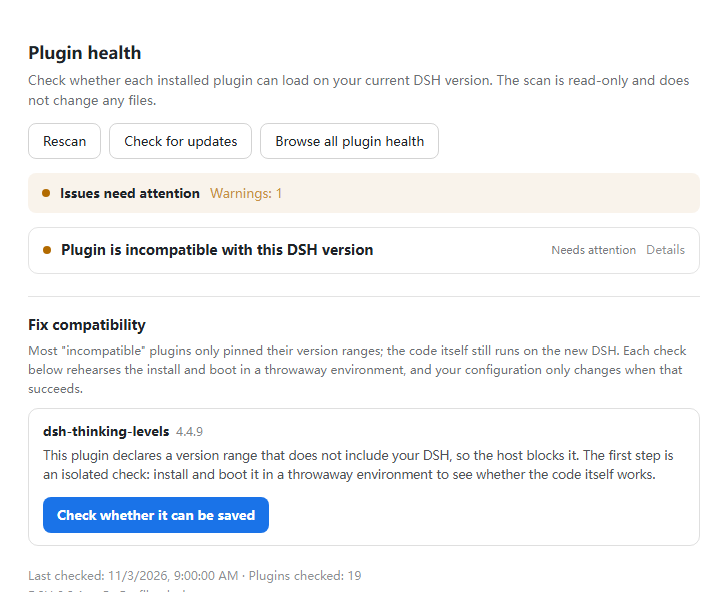
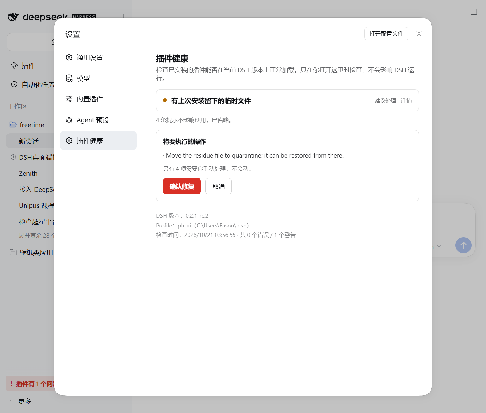

# dsh-plugin-health

[](https://github.com/EasonMWS/dsh-plugin-health/actions/workflows/ci.yml)
[](https://www.npmjs.com/package/dsh-plugin-health)
[](LICENSE)

**DSH 鏇存柊瀹岋紝鎻掍欢绐佺劧涓嶅姞杞戒簡锛熻繖涓伐鍏峰憡璇変綘鍝釜鍧忎簡銆佸摢涓兘鏁戙€佸摢涓晳涓嶄簡鈥斺€旂劧鍚庡府浣犱慨銆?*

澶ч儴鍒嗚鍒ゃ€屼笉鍏煎銆嶇殑鎻掍欢鍏跺疄娌″潖锛屽彧鏄綔鑰呮妸鐗堟湰鍙峰啓姝讳簡锛岃繕娌¤窡涓婃柊鐗?DSH銆?杩欎釜宸ュ叿浼氭妸姣忎釜鎻掍欢瑁呰繘涓€娆℃€х幆澧冪湡璺戜竴閬嶏紝纭鑳藉惎鍔ㄦ墠鍔ㄦ墜锛氫慨銆佷氦缁欎綘鑷繁鐨?AI銆?鎴栬€呭叧鎺夊畠璁?DSH 缁х画鑳界敤銆?
> 鐘舵€侊細`1.2.0`銆傚吋瀹瑰垽瀹氬畬鍏ㄥ榻愬畼鏂?DSH `0.2.1-rc.2` 鐨勮鍒欙紝绱㈠紩鐢卞畼鏂瑰彂甯冪殑
> `@deepseek-ai/dsh-plugin-market-index` 鏍￠獙鍣ㄩ獙璇併€?
```sh
npm install -g dsh-plugin-health
```

閲嶅惎 DSH 鈫?**璁剧疆 鈫?鎻掍欢鍋ュ悍**銆?
---

## 鐩綍

| 浣犳槸鈥?| 鐪嬭繖閲?|
| --- | --- |
| DSH 鐢ㄦ埛锛屾彃浠跺潖浜?| [淇涓€涓潖鎻掍欢](#淇涓€涓潖鎻掍欢) |
| DSH 瀹屽叏璧蜂笉鏉?| [DSH 璧蜂笉鏉ョ殑鏃跺€橾(#dsh-璧蜂笉鏉ョ殑鏃跺€? |
| 鎻掍欢浣滆€?| [鍦?CI 閲屾鏌ュ吋瀹规€(#鎻掍欢浣滆€呭湪姣忎釜-pr-涓婅嚜鍔ㄦ鏌ュ吋瀹规€? |
| 瑕佸仛鎻掍欢甯傚満 | [鎶婄储寮曞綋鏁版嵁婧怾(#鎶婃彃浠剁储寮曞綋鏁版嵁婧愮敤) |
| 鎯崇‘璁よ繖宸ュ叿瀹変笉瀹夊叏 | [瀹夊叏](#瀹夊叏) |

---

## 淇涓€涓潖鎻掍欢

鎵撳紑 **璁剧疆 鈫?鎻掍欢鍋ュ悍**銆傛瘡涓棶棰樹竴琛岋紝姣忎釜鎻掍欢涓€涓寜閽細

- **妫€鏌ヨ兘涓嶈兘鏁?* 鈥斺€?鍦ㄤ竴娆℃€х幆澧冮噷瑁呬竴閬嶃€佸惎鍔ㄤ竴閬嶏紙30~60 绉掞級銆備綘鐨勯厤缃竴鐐逛笉鍔ㄣ€?- **鑳藉惎鍔?* 鈫?*涓存椂鏀捐*銆傚線瀹夸富鑷繁鐨?`compatibility.json` 鍐欎竴鏉¤褰曪紝涓€閿彲鎾ら攢銆?- **璧蜂笉鏉?* 鈫?涓嶆彁渚涙斁琛屾寜閽€傜粰涓や釜閫夋嫨锛氬叧鎺夎繖涓彃浠讹紝鎴栬€呮嬁涓€浠芥彁绀鸿瘝浜ょ粰浣犵殑 AI銆?
姣忎竴姝ラ兘鍙挙閿€锛屼笉鍒犱换浣曟枃浠躲€?
## 鐗硅壊锛氬洓涓眰娆★紝涓嶆槸涓€灞?
闈欐€佹鏌ュ彧鏄涓€灞傗€斺€旇€屼笖**鍗曠嫭鐢ㄥ畠浼氱粡甯稿垽鏂敊璇紝閿欏埌鍗遍櫓鐨勭▼搴?*銆傚畬鏁磋矾寰勬槸杩欐牱鐨勶細

| # | 灞傛 | 鍋氫粈涔?| 鍦ㄥ摢璺?|
| --- | --- | --- | --- |
| **1** | **妫€娴?* | 鎵瘡涓凡瀹夎鎻掍欢锛坆undles銆乣dependencies`銆乣cordis.patch.yml` 鐨?insert 鍚祵濂椼€乣node_modules`锛夛紝鎶婂０鏄庡拰浣犲疄闄呰繍琛岀殑鐗堟湰瀵规瘮 | 浣犵殑鏈哄櫒 |
| **2** | **楠岃瘉** | 鍦?*涓€娆℃€?DSH home** 閲岃瘯锛氬厛鏀捐闂ㄧ锛屽啀鐪熻涓娿€佺湡鍚姩锛屾鏌ユ瘡涓?entry 鏄惁婵€娲?| 闅旂銆佺敤瀹屽嵆寮?|
| **3** | **淇** | 棰勬紨鑳藉惎鍔紝鎵嶅線**浣犵殑** profile 鍐欎竴鏉″畼鏂?`allow-version` 璞佸厤鈥斺€旀湁璁板綍锛屼竴閿挙閿€ | 浣犵殑 profile |
| **4** | **鍏滃簳** | 棰勬紨璧蜂笉鏉ワ紝灏变粈涔堥兘涓嶆敼锛岀粰涓や釜鐪熷疄閫夋嫨锛氬叧鎺夊畠锛屾垨鎷夸竴浠藉噯澶囧ソ鐨勬彁绀鸿瘝浜ょ粰浣犺嚜宸辩殑 AI銆備笂鎶ュ墠鍏堟煡涓婃父鏈夋病鏈変汉鎶ヨ繃 | 浣犲喅瀹?|

**绗?2 灞傛槸杩欎釜宸ュ叿瀛樺湪鐨勭悊鐢便€?* 娌℃湁瀹冿紝绗?3 灞傚氨鏄湪璧屻€?
## 涓轰粈涔堜腑闂磋繖灞傞噸瑕?
澶ч儴鍒嗚鎷掔殑鎻掍欢浠ｇ爜鏄ソ鐨勨€斺€斾綔鑰呮妸鐗堟湰鍙峰啓姝讳簡锛屾病璺熶笂鏂板涓汇€俙0.2.1-rc.4` 瀹炴祴锛?
| 鎻掍欢 | 澹版槑鐘舵€?| 闅旂鐜閲岀湡璺?|
| --- | --- | --- |
| `@nanmicoder/dsh-agent-teams@0.1.27` | 鉂?琚嫆 | 鉁?**瀹屾暣鍚姩锛?4 涓?entry 鍏ㄩ儴婵€娲?* |
| `dsh-find-plugin@0.4.0` | 鉂?琚嫆 | 鉁?**鐪熺殑鑳借窇** |
| `@feng0531/dsh-vcs@0.4.10` | 鉂?琚嫆 | 鉂?**澶辫触锛氬湪绛夊涓诲凡涓嶅啀鎻愪緵鐨勬湇鍔?* |

鍓嶄袱涓槸**鍋囪鎶?*鈥斺€斿彧鍋氶潤鎬佹鏌ョ殑宸ュ叿浼氭妸瀹冧滑鎶ユ垚鍧忔彃浠躲€?*绗笁涓鏄婕斿繀椤诲瓨鍦ㄧ殑鐞嗙敱**锛?鏀捐瀹冿紝鎭板ソ鍒堕€犲嚭闂ㄧ鎯抽伩鍏嶇殑缁撴灉鈥斺€斾竴涓兘鍔犺浇銆佷絾浼氬嚭闂鐨勬彃浠讹紝鑰屼笖鍐嶆病鏈変换浣曡鍛婄暀鐫€銆?

**杩欐剰鍛崇潃涓€浠朵簨锛氬彧鍋氶潤鎬佹鏌ョ殑宸ュ叿锛屼細鎶婅繖浜涜繕鑳界敤鐨勬彃浠惰鍒ゆ垚鍧忔彃浠躲€?*

## 鎵€浠ユ垜浠仛鐨勬槸鈥滃厛楠岃瘉锛屽啀鍔ㄦ墜鈥?
```
鎵弿鍙戠幇鎻掍欢琚嫆
  鈫?鍦ㄤ竴娆℃€т复鏃剁幆澧冮噷銆屽亣瑁呮斁琛?+ 鐪熺殑鍚姩涓€娆°€?  鈫?涓嶇浣犵殑 profile
  鈹溾攢 璧锋潵浜?鈫?浠ｇ爜娌￠棶棰橈紝鍙槸澹版槑杩囨椂
  鈹?   鈫?鍦ㄤ綘鐨?profile 閲屾斁琛岋紙鍙竴閿挙閿€锛?  鈹?   鈫?璁板綍鐘舵€侊紝鐩笂娓告湁娌℃湁鍙戞柊鐗?  鈹斺攢 璧蜂笉鏉?鈫?鐪熺殑涓嶅吋瀹癸紝鏀捐涔熸病鐢?       鈫?浠€涔堥兘涓嶆敼锛屾槑纭憡璇変綘
       鈫?闇€瑕佺殑璇濓紝甯綘鍑嗗濂界粰 AI 鐨勫畬鏁翠笂涓嬫枃
```

**椤哄簭寰堥噸瑕?*锛氬厛鏀捐鍐嶉獙璇侊紝浼氳浣犲甫鐫€涓€涓€岄棬绂佷笉鎷︿絾浼氬穿銆嶇殑鎻掍欢锛涙垜浠槸鍏堝湪闅旂鐜閲岃瘉鏄庤兘鐢紝鎵嶅姩浣犵殑閰嶇疆銆?
## 鍦ㄨ缃〉閲岄暱杩欐牱

瀹夎鍚庡湪 **璁剧疆 鈫?鎻掍欢鍋ュ悍** 閲岋細

- 姣忎釜涓嶅吋瀹规彃浠朵笅鏂规湁銆?*妫€鏌ヨ兘涓嶈兘鏁?*銆嶆寜閽?- 鐐逛簡浼氬湪涓存椂鐜璇曡璇曞惎鍔紙30~60 绉掞級锛屼笉淇敼浠讳綍涓滆タ
- 濡傛灉鑳界敤锛屽嚭鐜般€?*涓存椂鏀捐**銆嶆寜閽紱涓嶈兘鐢ㄥ垯鏄庣‘鍛婅瘔浣犳晳涓嶄簡
- 鏀捐杩囩殑鎻掍欢浼氳褰曞湪妗堬紝绛変笂娓稿彂鐗堝悗鎻愮ず浣犮€屽彲浠ユ仮澶嶅師鏍蜂簡銆?
鍏ㄩ儴鎿嶄綔閮藉彲鎾ら攢锛氭斁琛屽彧鍐欎竴涓畼鏂规敮鎸佺殑璞佸厤椤癸紝鎾ら攢浼氱簿纭仮澶嶅埌鏀捐鍓嶇殑鐘舵€併€?
## 鎻掍欢浣滆€咃細鍦ㄦ瘡涓?PR 涓婅嚜鍔ㄦ鏌ュ吋瀹规€?
**浣犱笉鐢ㄨ浠讳綍涓滆タ銆?* DSH 姣忎竴涓ゅ懆鍙戜竴涓鍙戝竷鐗堬紝鍐欐鐨?`engines.dsh` 灏变細瀹氭椂鎶婁綘鐨勬彃浠舵悶鎸傘€?杩欎釜 Action 浼氬湪 PR 閲屽憡璇変綘浼氫笉浼氭寕鈥斺€斿湪鐢ㄦ埛鍙戠幇涔嬪墠銆?
鍔犱竴涓枃浠?`.github/workflows/dsh-compat.yml`锛?
```yaml
name: dsh compatibility
on: [pull_request]
jobs:
  matrix:
    runs-on: ubuntu-latest
    steps:
      - uses: actions/checkout@v4
      - uses: EasonMWS/dsh-plugin-health@v1.1.0
        with:
          plugins: .
          versions: latest,next
```

瀹冧細鍦?PR 涓嬭瘎璁轰竴寮犲吋瀹规€ц〃锛屽苟杈撳嚭 `matrix.json`銆乣matrix.md` 鍜?SVG 寰界珷銆?
**鎸備簡灏辫鏋勫缓澶辫触銆?* 鍔?`failOn: any`锛屼笉鍏煎鏃?job 鐩存帴绾€傛洿绋崇殑鍋氭硶鏄彧鐩綘瑕佹敮鎸佺殑鐗堟湰锛?鏂?nightly 浼氭彁閱掍綘浣嗕笉浼氭尅浣忚础鐚€咃細

```yaml
        with:
          plugins: .
          versions: latest,next,alpha
          failOn: next          # 鍙湪 next 閫氶亾涓婂け璐?```

**鎶婄粨鏋滆创杩?README銆?* 杩愯浼氱敓鎴愬彲鐩存帴鎻愪氦鐨勫窘绔狅細

```markdown

```

杩欐槸鍥炵瓟銆岃繖涓滆タ鍦ㄥ綋鍓?DSH 涓婅繕鑳界敤鍚椼€嶆渶鐪佷簨鐨勬柟寮忊€斺€斿浣犮€佸闅忎究鐐硅繘浣犱粨搴撶殑浜洪兘涓€鏍枫€?
瀹屾暣鍙傛暟瑙?[`action.yml`](action.yml) 路 渚嬪瓙瑙?[`examples/dsh-compat.yml`](examples/dsh-compat.yml)銆?
## 鎶婃彃浠剁储寮曞綋鏁版嵁婧愮敤

濡傛灉浣犲湪鍋氭彃浠跺競鍦恒€佺洰褰曠珯銆佸惎鍔ㄥ櫒锛岃繖閲屾湁涓€浠界幇鎴愮殑 format-1 绱㈠紩锛?
```
https://easonmws.github.io/dsh-plugin-health/index.json
```

- **format-1** 鈥斺€?DSH 瀹樻柟甯傚満绱㈠紩鏍煎紡锛屾瘡娆℃瀯寤洪兘浼氭牎楠?- **300 涓彃浠?*锛屾瘡澶?UTC 04:23 閲嶅缓
- 姣忎釜鎻掍欢鍚細鍚嶇О銆佹弿杩帮紙涓嫳锛夈€佷綔鑰呫€佷粨搴撱€佷富椤点€佸垎绫汇€佷笅杞介噺銆丟itHub stars銆?  鍚彂寮忓仴搴峰垎銆佹渶杩戠増鏈巻鍙?- 鏁版嵁鏉ユ簮锛歔`awesome-dsh-plugin.com/plugins.json`](https://awesome-dsh-plugin.com/plugins.json)

鍋ュ悍鍒嗘槸鍚彂寮忕殑锛屼笉鏄畨鍏ㄨ瘎绾с€備笅杞介噺鍜?stars 鏉ヨ嚜 npm 涓?GitHub 鐨勫叕寮€鏁版嵁銆?
## 瀹夊叏

**杩樺湪鐢?1.0.3 鎴栨洿鏃╋紵璇峰崌绾с€?* 1.1.0 淇浜嗗畨鍏ㄦ祴璇曞湪 1.0.2 閲屽彂鐜扮殑 7 涓棶棰橈紝
鍏朵腑涓€涓瘎涓?high锛氬啓璺敱鐨勬帶鍒跺瘑閽ヨ鏃犻壌鏉冪殑 status 鎺ュ彛涓嬪彂浜嗐€?
瑙?[GHSA-vj8q-543v-9hw5](https://github.com/EasonMWS/dsh-plugin-health/security/advisories/GHSA-vj8q-543v-9hw5)
鍜?[SECURITY.md](SECURITY.md)銆?
**淇′换杈圭晫锛岀洿璇达細** 鍐欒矾鐢卞**浠讳綍鏈湴杩涚▼**鍙揪銆傜湡姝ｇ殑杈圭晫鏄?loopback 鎺ュ彛锛屼笉鏄偅涓瘑閽ャ€?
## 瀹夊叏杈圭晫锛堣鍔″繀璇讳竴閬嶏級

> **瀹夊叏鎻愮ず锛?* 1.1.0 淇浜嗗畨鍏ㄦ祴璇曞湪 1.0.2 閲屽彂鐜扮殑 7 涓棶棰橈紝鍏朵腑涓€涓瘎涓?high 鈥斺€?> 鍐欒矾鐢辩殑鎺у埗瀵嗛挜琚棤閴存潈鐨?status 鎺ュ彛涓嬪彂浜嗐€?*濡傛灉浣犲湪鐢?1.0.3 鎴栨洿鏃╋紝璇峰崌绾с€?*
> 璇︽儏瑙?> [GHSA-vj8q-543v-9hw5](https://github.com/EasonMWS/dsh-plugin-health/security/advisories/GHSA-vj8q-543v-9hw5)
> 涓?[SECURITY.md](SECURITY.md)銆傞偅閲屼篃鎶婁俊浠昏竟鐣屽啓娓呮浜嗭細鍐欒矾鐢卞**浠讳綍鏈湴杩涚▼**鍙揪锛?> 鐪熸鐨勮竟鐣屾槸 loopback 鎺ュ彛鏈韩銆?
| 鎴戜滑鍋氫粈涔?| 鎴戜滑涓嶅仛浠€涔?|
| --- | --- |
| 鍦ㄩ殧绂荤殑涓存椂 home 閲岃瘯瑁呰瘯鍚姩 | 鉂?涓嶈嚜鍔ㄨ皟鐢ㄤ綘鐨?AI锛屼笉鑺变綘鐨?token |
| 浣跨敤 DSH 瀹樻柟 `allow-version` 璞佸厤鏈哄埗 | 鉂?涓嶄慨鏀规彃浠舵簮鐮侊紝涓嶆敼 npm 涓婄殑鍖?|
| 璁板綍姣忎竴娆℃敼鍔紝鏀寔绮剧‘鎾ら攢 | 鉂?楠岃瘉澶辫触鏃剁粷涓嶆斁琛?|
| 甯綘妫€鏌ヤ笂娓告槸鍚﹀凡鏈変汉鎶ヨ繃 issue | 鉂?涓嶆浛浣犳彁浜?issue |
| 鍑嗗濂藉畬鏁寸殑 AI 涓婁笅鏂囧寘 | 鉂?涓嶆浛浣犳寜涓嬪彂閫侀敭 |

**涓存椂鏀捐 = 闂ㄧ鏀捐锛屼笉绛変簬瀹樻柟鏀寔銆?* 鎴戜滑鍙繚璇佸畠鍦ㄩ殧绂荤幆澧冮噷鑳藉惎鍔紱
鎻掍欢鐨勫叿浣撳姛鑳芥槸鍚﹀畬鍏ㄦ甯革紝浠嶉渶浣犺嚜宸辫瀵熴€傜瓑浣滆€呭彂甯冩寮忔敮鎸佺増鏈悗锛岃鎾ら攢涓存椂鏀捐骞跺崌绾с€?
## 1.0 鎵胯浠€涔?
澶х増鏈彿鏄绋冲畾鎬х殑鎵胯锛屾墍浠ヨ繖閲屾妸**鍐荤粨鐨?*鍜?*杩樻病鍐荤粨鐨?*閮借娓呮锛岃€屼笉鏄浣犲崌绾ф椂鎵嶅彂鐜般€?
**鍐荤粨**鈥斺€?.x 鍐呬笉浼氱牬鍧忥細

| 闈?| 淇濊瘉 |
| --- | --- |
| CLI 鍛戒护涓庡弬鏁帮紙`matrix`銆乣smoke`銆乣doctor`銆乣repair`銆乣rescue`銆乣handoff`銆乣report`銆乣boot`銆乣index`锛?| 鐜版湁鍙傛暟鍚箟涓嶅彉銆傚彲浠ユ柊澧炲弬鏁帮紝浣嗕笉浼氬垹闄ゆ垨鏀瑰彉鍚箟 |
| `plugin_health` agent 宸ュ叿鐨勫悕瀛椾笌杈撳叆 schema | 鍙瀛楁锛屼笉鏀瑰凡鏈夊瓧娈?|
| 閫€鍑虹爜锛坄0` 鎴愬姛 / `1` 鏈夐棶棰樻垨澶辫触 / `2` 鐢ㄦ硶閿欒锛?| 涓嶅彉 |
| 鏈伐鍏峰啓鍑虹殑鏂囦欢锛坄compatibility.json`銆乣plugin-health-rescue.json`銆佷氦鎺ュ寘锛?| 鏍煎紡鏈夋枃妗ｄ笖鍚戝墠鍏煎锛氫笉璁よ瘑鐨勯敭浼氫繚鐣欙紝涓嶄涪寮?|
| 鐘舵€佽矾鐢辩粨鏋勶紙`/plugins/dsh-plugin-health/status`锛?| 鍙瀛楁锛屽凡鏈夊瓧娈靛悕涓庣被鍨嬩笉鍙?|

**鏈喕缁?*鈥斺€斿彲鑳藉湪 minor 鐗堟湰鍙樺寲锛屽洜涓哄畠浠睘浜庡睍绀哄眰鎴栧唴閮ㄥ疄鐜帮細

- UI 鏂囨銆佸竷灞€銆侀厤鑹层€佽缃潰鏉跨殑缁撴瀯锛?- 鐢熸垚鐨?AI 鎻愮ず璇嶅拰 issue 鑽夌閲岀殑寤鸿鎺緸锛?- `src/` 涓嬬殑鍐呴儴妯″潡鍒掑垎锛堥櫎 `./api` 鍜?`./client` 涓や釜瀵煎嚭锛宍src/` 涓嶆槸鍏紑瀵煎叆璺緞锛夛紱
- 宸叉枃妗ｅ寲涔嬪鐨?finding id鈥斺€旀柊澧炴鏌ヤ細甯︽潵鏂?id銆?
**瀹夸富鍗囩骇鏃剁殑鐗堟湰绛栫暐銆?* `engines.dsh` 鍐欑殑鏄?*鑼冨洿**锛坄>=0.1.0-rc.6 <0.3.0-0`锛夎€屼笉鏄灇涓撅紝
鎵€浠ユ柊鐨?DSH nightly 涓嶄細鍍忔墦鏂偅浜涘啓姝荤増鏈殑鎻掍欢閭ｆ牱鎵撴柇鏈彃浠躲€傜瓑 DSH 0.3.0 鍙戝竷鏃讹紝
鏈寘闇€瑕佸彂涓€鐗堟墿灞曡繖涓寖鍥粹€斺€?*杩欐槸鍞竴宸茬煡鐨勮繃鏈熺偣**锛屼細鎻愬墠鍐欒繘 changelog銆?
## DSH 璧蜂笉鏉ョ殑鏃跺€?
鎻掍欢鍧忎簡瀵艰嚧 DSH 鏍规湰鍚姩涓嶄簡鏃讹紝璁剧疆椤佃嚜鐒朵篃鎵撲笉寮€鈥斺€旈偅浜涘姛鑳介兘璺戝湪 DSH 閲岄潰銆?鎵€浠ヨ繖涓変釜鍛戒护**瀹屽叏鐙珛浜?DSH**锛屽彧瑕佽兘寮€缁堢灏辫兘鐢細

```sh
# 1. 鍏堢湅涓轰粈涔堣捣涓嶆潵锛堣瀹夸富鐣欎笅鐨勬棩蹇楀拰闈欐€佹鏌ワ級
dsh-plugin-health boot diagnose --profile desktop

# 2. 瀹炲湪鏌ヤ笉鍑猴紝灏卞厛鎶婃墍鏈夌涓夋柟鎻掍欢鍋滄帀锛岃 DSH 鑳藉惎鍔?dsh-plugin-health boot safe --profile desktop --apply

# 3. 鎵惧埌鍏冨嚩銆佷慨濂戒箣鍚庯紝鎭㈠鍘熺姸
dsh-plugin-health boot restore --profile desktop --apply
```

`boot safe` 鍙線 profile 鑷繁鐨勮ˉ涓佸眰杩藉姞 `disabled: true`锛?**涓嶅垹鏂囦欢銆佷笉鍔ㄦ彃浠躲€佸涓昏嚜甯︽潯鐩竴寰嬩笉纰?*銆俙boot restore` 鍙Щ闄ゅ畠鑷繁鍔犵殑鏉＄洰锛?浣犺嚜宸辩殑閰嶇疆鍘熸牱淇濈暀銆備袱鑰呴粯璁ら兘鏄?dry-run锛屽姞 `--apply` 鎵嶇湡姝ｅ啓銆?
## 浣犲湪鎵锯€滄彃浠剁鐞嗗櫒 / 鎻掍欢妫€鏌?/ 鎻掍欢鍐茬獊妫€娴嬧€濆悧锛?
濡傛灉浣犲湪鎼滀笅闈换浣曚竴涓紝閭ｄ綘瑕佺殑灏辨槸杩欎釜锛?
| 浣犲湪鎵锯€?| 杩欎釜鍖呰兘鍋氬埌 |
| --- | --- |
| DSH 鐨?*鎻掍欢绠＄悊鍣?* | 涓€椤电湅鍏ㄦ墍鏈夊凡瀹夎鎻掍欢鍙婄姸鎬?|
| **鎻掍欢妫€鏌?/ 浣撴 / 鎵弿**宸ュ叿 | 鎵弿鍏ㄩ儴宸插畨瑁呮彃浠讹紝涓嶆槸鎶芥牱 |
| **鎻掍欢璇婃柇 / doctor** | 璇存竻鍝噷鍧忎簡銆佽鎬庝箞澶勭悊 |
| **鎻掍欢鍐茬獊**妫€娴?| 鎸囧嚭鍝簺鎻掍欢鍦ㄥ綋鍓?DSH 鐗堟湰涓婂姞杞戒笉浜?|
| 鎯?*淇鍧忔帀鐨勬彃浠?* | 涓€閿慨澶嶏紙鍙殧绂讳笉鍒犻櫎锛岄殢鏃跺彲鎵惧洖锛?|
| **DSH 鏇存柊鍚庢彃浠剁獊鐒朵笉鑳界敤浜?* | 瀵规瘮鎻掍欢澹版槑涓庢柊瀹夸富瑕佹眰 |
| plugin manager / plugin doctor / plugin checker / plugin conflict | 鑻辨枃鐣岄潰鍚屾牱鏀寔 |

**涓嶉€傚悎浣?*锛氬鏋滀綘鎯斥€滈€涘競鍦恒€佸彂鐜板苟瀹夎鏂版彃浠垛€濃€斺€旈偅鏄彃浠跺競鍦虹殑娲伙紝杩欎釜鍖呯鐨勬槸浣犲凡缁忚浜嗕粈涔堛€?锛堜笉杩囧畼鏂?format-1 绱㈠紩姝ｆ槸鐢卞畠鐢熸垚鐨勶紝甯傚満鍙互娑堣垂銆傦級

## 涓轰粈涔堥渶瑕佸畠锛欴SH 绠′綇浜嗗畨瑁咃紝浣嗘病绠″崌绾?
DSH 浼氭嫆缁?*鏂板畨瑁?*涓€涓０鏄庤寖鍥翠笉鍖归厤褰撳墠鐗堟湰鐨勬彃浠讹紝杩欏潡鍋氬緱寰堟墡瀹烇細

```
$ dsh plugin --profile test add dsh-session-recall
dsh: installation rejected: Plugin dsh-session-recall@0.7.9 is incompatible with dsh 0.2.1-rc.3
dsh: nothing was installed.
```

浣嗗畠**涓嶄細**鍦ㄥ涓诲崌绾у悗閲嶆柊妫€鏌ュ凡缁忚濂界殑鎻掍欢銆備竴涓０鏄?`engines.dsh: 0.2.1-rc.2` 鐨勬彃浠?渚濇棫鐣欏湪 `bundles` 閲屻€佷緷鏃у湪 `0.2.1-rc.3` 涓婂姞杞斤紝UI 閲屾病鏈変换浣曟彁绀恒€傝繖灏辨槸鏈伐鍏疯琛ョ殑缂哄彛锛?璇诲嚭姣忎釜宸插畨瑁呮彃浠惰嚜宸卞０鏄庣殑鑼冨洿锛屽拰浣犲疄闄呭湪璺戠殑鐗堟湰鍋氬姣斻€?
## 瀹冨凡缁忔姄鍒拌繃鐪熷疄闂

鍦ㄤ竴娆″涓诲皬鐗堟湰鍗囩骇涓壂鎻?Top 120 鎻掍欢锛屽彂鐜?**5 涓湪 `0.2.1-rc.2` 涓婃甯搞€佸埌 `0.2.1-rc.3` 灏辫鎷?*銆?閫愪釜鎻愭姤鍚庯紝浣滆€呬滑鍔ㄤ簡鎵嬧€斺€?*5 涓噷宸叉湁 4 涓彂甯冧慨澶?*锛?026-10-26 澶嶆祴锛夛紝鍙楀奖鍝嶆暟 **5 鈫?1**锛?
> 宸茬敤鍙戝竷鐨?0.1.47 manifest 鍜屽畼鏂?rc.3 瀹夸富鍏煎鎬ц瘎浼板櫒澶嶆牳纭锛?*19 涓?DSH peer 琚嫆**锛?> 鑰?rc.2 浠嶇劧閫氳繃銆傚凡鍦?#179 鍚堝叆 main 淇鈥︹€︿節涓?PR CI 鍏ㄩ儴閫氳繃锛屽叾涓?*鏂板浜嗗繀闇€鐨?rc.3 Profile 妫€鏌?*銆?>
> 鈥?[Anionex/dsh-vision-toolkit#178](https://github.com/Anionex/dsh-vision-toolkit/issues/178#issuecomment-6388178989)
> 锛?06鈽咃級锛屽洜鏈鎵弿鑰屼慨澶嶏紝宸查殢 `0.1.48` 鍙戝竷

| 鎻掍欢 | 淇鐗堟湰 | 鐘舵€?|
| --- | --- | --- |
| `@anionex/dsh-vision-toolkit` | `0.1.48` | 鉁?宸插彂甯冿紝rc.2 + rc.3 鍙岀増鏈娴嬮€氳繃 |
| `dsh-plugin-subscriptions` | `0.9.11` | 鉁?宸插彂甯冿紝rc.2 + rc.3 鍙岀増鏈娴嬮€氳繃 |
| `@nanmicoder/dsh-agent-teams` | `0.1.27` | 鉁?宸插彂甯冿紝rc.2 + rc.3 鍙岀増鏈娴嬮€氳繃 |
| `@goodandready/dsh-clinebot` | `0.6.16` | 鉁?宸插彂甯冿紝rc.2 + rc.3 鍙岀増鏈娴嬮€氳繃 |
| `dsh-workbuddy-connect` | 鈥?| 鈿狅笍 浠嶄负 `0.7.9`锛堜粨搴撲笉鍙闂紝鏄敮涓€杩?issue 閮芥彁涓嶄簡鐨勪竴涓級 |

瀹屾暣鎶ュ憡锛歔docs/upgrade-0.2.1-rc3.md](docs/upgrade-0.2.1-rc3.md)銆?
## 鏈?UI锛屼絾鍙湪浣犻渶瑕佹椂鍑虹幇

鎶婂畠浣滀负 bundle 瑁呰繘 profile锛孌SH 璁剧疆閲屼細澶氬嚭涓€涓師鐢熷垎鍖?**璁剧疆 鈫?鎻掍欢鍋ュ悍**锛?
```sh
dsh plugin --profile web add dsh-plugin-health
```

- **瀹冩鏌ョ殑鏄綘鏈哄櫒涓婄湡瀹炲畨瑁呯殑姣忎竴涓彃浠?*锛屼笉鏄娊鏍凤紝涔熶笉鍙湅 bundle 鍒楄〃锛?  bundle銆乣package.json` 渚濊禆銆乣cordis.patch.yml` 鐨?insert锛堝惈宓屽锛夈€乣node_modules` 閲屾墍鏈夋彃浠跺舰鎬佺殑鍖呫€?  椤甸潰椤堕儴浼氱洿鎺ュ憡璇変綘杩欐妫€鏌ヤ簡澶氬皯涓€?- 姣忔潯闂閮界敤澶х櫧璇濊В閲婏紝骞剁粰鍑恒€屾€庝箞鍋氥€嶏紝绗竴娆＄敤鐨勪汉涓嶇敤璇绘枃妗ｄ篃鑳藉鐞嗭紱
- 椤堕儴涓€琛岀粨璁哄憡璇変綘璇ヤ笉璇ユ媴蹇冿細`鍙互鏀惧績鐢╜ 鎴?`鏈夐棶棰樺缓璁鐞哷锛涙梺杈规湁 `閲嶆柊鎵弿` 鎸夐挳闅忔椂閲嶈窇锛?- **涓€鍒囨甯告椂浠€涔堥兘涓嶆樉绀?*锛氭病鏈夊窘绔犮€佹病鏈夋í骞呫€佹病鏈変晶鏍忔潯鐩紱
- **鐪熺殑鏈夐棶棰樻椂**锛岃处鍙疯彍鍗曚笂鏂逛細鍑虹幇涓€涓?`鎻掍欢鏈?N 涓棶棰榒 鐨勫皬鍏ュ彛锛岀偣涓€涓嬬洿鎺ヨ烦鍒拌缃垎鍖猴紱
- host 鍗婅韩鍙彁渚?loopback 鍙蹇収锛屼笉浼氫慨鏀逛綘鐨?profile銆?
| 闂鍒楄〃 + 缁撹琛?+ 涓€閿慨澶?| 鎵ц鍓嶅厛缁欎綘鐪嬩慨澶嶈鍒?|
| --- | --- |
|  |  |

> **鍑嗗鍗囩骇 DSH锛熷厛璺戜竴閬嶄綋妫€銆?*
>
> `0.2.1-rc.3`锛?026-10-23锛夎 Top 120 閲岀殑鍏煎鏁颁粠 118 鎺夊埌 **113**锛?> **5 涓湪 rc.2 涓婃甯哥殑鎻掍欢锛屽埌 rc.3 灏卞姞杞戒笉浜?*锛屽師鍥犻兘鏄妸 `@deepseek-ai/*` 鐗堟湰鍐欐垚浜嗙簿纭灇涓俱€?> 鎴嚦 2026-10-26锛屽叾涓?**4 涓凡淇鍙戠増**锛堝彈褰卞搷鏁?5 鈫?1锛夈€?> 鏇存棭鐨?rc.2 涔熸浘鎵撳穿鍙﹀ 3 涓€傛渶鏂版姤鍛婏細
> [docs/upgrade-0.2.1-rc3.md](docs/upgrade-0.2.1-rc3.md) 路
> [docs/upgrade-0.2.1.md](docs/upgrade-0.2.1.md)銆?>
> ```sh
> dsh-plugin-health matrix --plugins plugins.txt --versions 0.2.1-rc.2,0.2.1-rc.3
> ```

## 涓轰粈涔堝仛

DSH 娌℃湁瀹樻柟鎻掍欢甯傚満绱㈠紩锛涘彂琛岃妭濂忕害 **2.1 澶╀竴涓増鏈?*涓斿甫鐮村潖鎬у彉鏇达紱瀹樻柟鎻掍欢绠＄悊鍣ㄦ病鏈?鐗堟湰閫夋嫨/鍗囩骇鍔ㄤ綔锛沇indows/WSL 瀹夎澶辫触浼氱暀涓嬫畫缂虹洰褰曞拰娈嬬暀閿佹枃浠躲€傜幇鏈?doctor/甯傚満宸ュ叿
鍙獙璇佲€滄湰鏈哄綋鍓嶅畨瑁呯殑閭ｄ竴涓?DSH 鐗堟湰鈥濓紝涔熶笉澶勭悊 Windows 鏂囦欢閿佸拰璺?profile 闂銆?
杩欎釜宸ュ叿琛ヤ笁涓己鍙ｏ細

1. **澶氬涓诲吋瀹圭煩闃?*锛氭彃浠惰兘涓嶈兘鍦?`0.1.7-rc.2` / `0.2.0-rc.2` / `0.2.1-alpha.4` /
   `0.2.1-rc.2` 涓婂姞杞斤紵浣跨敤瀹樻柟璇箟绮剧‘鍒ゅ畾锛坄engines.dsh` 浼樺厛锛屽惁鍒欐鏌?   `@deepseek-ai/dsh*` peers锛涢鍙戝竷鍙備笌 range锛沗workspace:` 鏄犲皠鍒板涓荤増鏈級銆?2. **瀹樻柟 format-1 甯傚満绱㈠紩**锛氭妸绀惧尯鐩綍鍙樻垚鍐呯疆 **Discover** 鑳界洿鎺ュ悆鐨?JSON 绱㈠紩锛屽苟鐢?   DSH Host 鍚屾瑙ｆ瀽鍣ㄩ獙璇併€?3. **Windows/WSL 瀹夎璇婃柇**锛氶粯璁ゅ彧璇伙紱淇鍔ㄤ綔鍙殧绂讳笉鍒犻櫎锛屾敼 patch 淇濈暀鐢ㄦ埛娉ㄩ噴銆?
## 瀹夎

```sh
npm install -g dsh-plugin-health
# 鎴栭鍙戝墠鏈湴杩愯锛?git clone https://github.com/EasonMWS/dsh-plugin-health.git && cd dsh-plugin-health && npm ci
node bin/dsh-plugin-health.js --help
```

闇€瑕?Node.js 20+銆?
### 浣滀负 DSH bundle 瀹夎锛堝彲閫夛級

杩欎釜鍖呭悓鏃舵槸涓€涓彲瀹夎鐨?DSH bundle銆傝杩?profile 鍚庝細鎻愪緵涓€涓彧璇荤殑 `plugin_health` agent
宸ュ叿锛屾姤鍛婏細澹版槑浣嗘湭瀹夎鐨勭涓夋柟 bundle銆佹畫缂虹殑鍖呯洰褰曘€乣cordis.patch.yml` 娈嬬暀銆佷唬鐞?registry
閰嶇疆銆乸rofile 宸紓锛屼互鍙婂凡瑁呮彃浠朵笌褰撳墠 DSH 鐗堟湰鐨勪笉鍏煎銆?
```sh
dsh plugin --profile web add dsh-plugin-health
```

bundle 澹版槑浜?`engines.dsh`锛屼笉甯?UI锛岃嚜韬笉鏀瑰彉浠讳綍涓滆タ銆?
## 1. 鍏煎鐭╅樀

```sh
dsh-plugin-health matrix \
  --plugins examples/plugins.txt \
  --versions latest,next,alpha,0.1.7-rc.2 \
  --out dsh-health-out/matrix \
  --fail-on any
```

- `--plugins`锛氭枃浠讹紙涓€琛屼竴涓紝鏀寔 `#` 娉ㄩ噴锛夈€侀€楀彿鍒楄〃锛屾垨閲嶅鍙傛暟锛涙瘡椤规槸 `name`銆?  `name@version`锛屾垨鏈湴鎻掍欢鐩綍銆?- `--versions`锛氱簿纭?SemVer锛屾垨 `@deepseek-ai/dsh` 鐨?npm dist-tag锛坄latest`/`next`/`alpha`锛夈€?- 杈撳嚭锛歚matrix.json`銆乣matrix.md`銆侀潤鎬?SVG 寰界珷锛坄badges/`锛夈€?- `--fail-on any|none|<host>`锛氱洿鎺ョ敤浣?CI 闂ㄧ銆?
鍒ゅ畾瑙勫垯涓庡畼鏂?`packages/boot/app-boot/src/plugin-compatibility.ts` 涓€鑷达細

| 鎻掍欢澹版槑 | 妫€鏌?|
|---|---|
| `engines.dsh` | 鍙湅杩欎釜 range锛屽拷鐣?peers |
| 鏃?`engines.dsh`銆佹湁 peers | 鎵€鏈?`@deepseek-ai/dsh` / `@deepseek-ai/dsh-*` peer range |
| peer 涓?`workspace:^` / `~` / `*` | 瑙嗕负褰撳墠瀹夸富鐗堟湰 |
| 瀹夸富涓洪鍙戝竷 | 鍙備笌 range 姣旇緝锛坄includePrerelease: true`锛?|

鐭╅樀鏄?*闈欐€佸垽瀹?*锛坢anifest + 瀹樻柟鍏煎瑙勫垯锛夈€傚０鏄庡吋瀹逛笉浠ｈ〃鎻掍欢宸叉縺娲汇€佸伐鍏疯兘鎵ц锛?鍙互鐢ㄤ笅闈㈢嫭绔嬨€佹樉寮忔墽琛岀殑 `smoke` 鍛戒护琛ュ厖杩愯鏃堕獙鏀躲€侴it 鎻掍欢浠嶅彲浠庢湰鍦扮洰褰曞仛闈欐€佹鏌ャ€?
### 鍦ㄥ叏鏂?profile 涓仛杩愯鏃堕獙鏀?
鍏堟妸鐩爣瀹夸富鐗堟湰瀹夎鍒扮嫭绔嬬洰褰曪紝鍐嶉獙鏀剁敤鎴峰疄闄呭畨瑁呯殑鍖咃紝鍖呮嫭鍙戝竷鐢ㄧ殑 tarball锛?
```sh
npm install --prefix /tmp/dsh-rc3 @deepseek-ai/dsh@0.2.1-rc.3
dsh-plugin-health smoke \
  --dsh-dir /tmp/dsh-rc3/node_modules/@deepseek-ai/dsh \
  --plugin ./my-plugin-1.0.0.tgz \
  --tool my_plugin_tool \
  --calls ./smoke-calls.json \
  --out dsh-health-out/runtime
```

`smoke-calls.json` 鏄伐鍏疯皟鐢ㄦ暟缁勩€傝皟鐢ㄥ繀椤绘垚鍔燂紱鎻愪緵 `expectedValue` 鏃惰繕浼氱簿纭瘮杈冨畬鏁寸殑
缁撴瀯鍖栬繑鍥炲€硷細

```json
[{"name":"my_plugin_tool","arguments":{"input":"example"},"expectedValue":{"answer":42}}]
```

鍛戒护浣跨敤鍏ㄦ柊鐨?`DSH_HOME`锛岄€氳繃瀹樻柟 `dsh plugin` CLI 瀹夎锛岀粡瀹夸富鍏紑鐨?`@deepseek-ai/dsh/profile-boot` 鍚姩锛岀劧鍚庢鏌ュ伐鍏锋敞鍐屻€佹墽琛岃皟鐢ㄣ€侀噴鏀?profile銆?鑷冲皯鎻愪緵涓€涓?`--tool` 鎴?`--calls` 鏂█銆傚彧鏈?`--tool` 鏃朵粎妫€鏌ユ敞鍐岋紝涓嶄唬琛ㄥ姛鑳芥垨娴忚鍣?UI
宸茬粡楠屾敹銆傛瘡涓涓荤増鏈垎鍒繍琛屼竴娆°€?
瀹夎榛樿鏈€澶?120 绉掞紝鍚姩銆佽皟鐢ㄤ笌閫€鍑哄悎璁℃渶澶?30 绉掞紝鍙敤 `--install-timeout`銆乣--timeout`
璋冩暣锛堟绉掞級銆傝秴鏃朵細鍋滄鏁翠釜瀛愯繘绋嬫爲锛屽寘鎷竴鐩翠笉缁撴潫鍒濆鍖栫殑鎻掍欢銆傛姤鍛婁繚鐣欏け璐ラ樁娈?锛坄install`銆乣boot`銆乣assertions`銆乣shutdown`锛変笌瀹夸富閿欒锛屽嵆浣胯秴鏃跺悗鐨勪俊鍙峰鐞嗕互 0 閫€鍑猴紝
杩欐楠屾敹浠嶇劧澶辫触銆?POSIX 涓嬶紝鐖惰繘绋嬩互 0 閫€鍑哄嵈鐣欎笅鍚庡彴瀛愯繘绋嬫椂锛屽悓鏍峰垽瀹氬け璐ュ苟鍋滄鍏惰繘绋嬬粍銆俉indows 瓒呮椂
浣跨敤 `taskkill /T`锛涚洰鍓嶄笉鑳藉湪鐖惰繘绋嬪凡缁忛€€鍑哄悗妫€娴嬪叾閬楃暀瀛愯繘绋嬨€?
姣忔杩愯閮戒繚鐣欑嫭绔嬬洰褰曚腑鐨?home銆乣smoke.json`銆乣runtime.json` 涓庢湁闀垮害涓婇檺鐨勮緭鍑烘棩蹇楋紝
涓嶄細淇敼鐜版湁 profile锛屼篃涓嶈嚜鍔ㄦ竻鐞嗐€傚垎浜墠璇锋鏌ユ棩蹇椼€傜洰鏍囧涓婚渶瑕佽嚜宸辩殑 Node.js銆乸npm
杩愯瑕佹眰锛屽苟闇€瀵煎嚭 `profile-boot`锛堝凡鍦?`0.2.1-rc.2`銆乣0.2.1-rc.3` 楠岃瘉锛夈€?
**姝ゅ懡浠や細浠ュ綋鍓嶇郴缁熻处鍙锋潈闄愭墽琛屾彃浠朵唬鐮併€?* 涓存椂 DSH home 鍙殧绂绘甯?profile锛屼笉鏄畨鍏?娌欑锛涘彧娴嬭瘯鍙俊浠ｇ爜锛屼笉鍙俊浠ｇ爜璇锋斁鍦ㄥ鍣ㄦ垨铏氭嫙鏈轰腑銆傝繍琛屾椂鍐掔儫涔熶笉淇濊瘉鎵€鏈夊姛鑳芥垨 UI
閮藉吋瀹广€?
### 瀹炶窇绀轰緥锛?026-10-17锛? 涓彃浠?脳 4 涓涓荤増鏈級

```
dsh 0.1.7-rc.2: 6/7 compatible, 1 incompatible
dsh 0.2.0-rc.2: 5/7 compatible, 2 incompatible
dsh 0.2.1-alpha.4: 5/7 compatible, 2 incompatible
dsh 0.2.1-rc.2: 5/7 compatible, 2 incompatible
鉁?dsh-win32@0.17.14锛氬洓涓涓诲叏涓嶅吋瀹癸紙@deepseek-ai/dsh-subprocess-local 鐨?peer 涓婄晫杩囩獎锛?鉁?dsh-find-plugin@0.4.0锛氫粠 0.2.0-rc.2 璧蜂笉鍏煎锛園deepseek-ai/dsh-tools peer锛?```

绗竴鏉℃濂藉鐜颁簡 dsh-win32 issue #89锛坧eer 涓婄晫杩囩獎瀵艰嚧鏂板涓荤嚎琚嫆缁濓級鐨勭湡瀹為棶棰橈紝鑰屼笖
涓嶉渶瑕佸畨瑁呬换浣曚笢瑗裤€?
### GitHub Action锛氭瘡涓?PR 鑷姩璐村吋瀹圭煩闃?
浠撳簱鍐呯疆鍙鐢?workflow銆傛妸 [`examples/dsh-compat.yml`](examples/dsh-compat.yml) 鏀捐繘鎻掍欢浠撳簱鐨?`.github/workflows/dsh-compat.yml`锛屼箣鍚庢瘡涓?PR 閮戒細鏀跺埌涓€鏉″吋瀹圭煩闃佃瘎璁?+ job summary锛屽苟涓?鐭╅樀浜х墿浼氳嚜鍔ㄤ笂浼犱负 artifact锛?
```yaml
name: dsh plugin compatibility
on: pull_request
permissions:
  contents: read
  pull-requests: write
jobs:
  matrix:
    uses: EasonMWS/dsh-plugin-health/.github/workflows/matrix-review.yml@v0.1.5
    with:
      plugins: '.'
      versions: 'latest,next,alpha'
      comment: true
```

## 2. Windows/WSL 璇婃柇涓庝慨澶?
```sh
dsh-plugin-health doctor --home C:\Users\me\.dsh --profile desktop --runtime 0.2.1-rc.2
dsh-plugin-health repair --home C:\Users\me\.dsh --profile desktop --apply --yes
```

妫€鏌ラ」锛歱rofile 澹版槑浣嗘湭瀹夎鐨勭涓夋柟 bundle锛圖SH 瀹夎鑷甫鐨?`@deepseek-ai/*` 瑙嗕负宸叉彁渚涳級銆?涓嶅彲璇?娈嬬己鐨勫寘鐩綍銆佺己澶辩殑 profile 渚濊禆銆佹崯鍧忔垨绌虹殑 `cordis.patch.yml` 鏉＄洰銆?`.bak-*` / `.lock` / `.lock.takeover-*` 娈嬬暀銆佽繃澶х殑鎻掍欢绠＄悊鍣ㄦ棩蹇椼€侀厤浜嗕唬鐞嗕絾娌¤
`NODE_USE_ENV_PROXY=1`銆乄SL 涓?Windows 闀胯矾寰勩€佹寜 `--runtime` 妫€鏌ュ凡瑁呮彃浠舵槸鍚﹀吋瀹广€佷互鍙?desktop/web 绛?profile 涔嬮棿鐨勬彃浠堕泦宸紓銆?
淇蹇呴』鏄惧紡 `--apply`锛岄粯璁?dry-run锛屼笖**鍙殧绂讳笉鍒犻櫎**锛?
- 鏂囦欢鍜岀洰褰曠Щ鍒?`<home>/.plugin-health/quarantine/<鏃堕棿鎴?/`锛宍repair-log.json` 璁板綍姣忎竴姝ワ紱
- `cordis.patch.yml` 鍙仛鏂囨湰绾у垹闄わ紙椤跺眰 `- []` 鏉＄洰锛夛紝鍏堝浠斤紝淇濈暀鐢ㄦ埛娉ㄩ噴涓庢牸寮忋€?
## 璺嚎鍥?
- 娴忚鍣ㄦ彃浠剁殑杩愯鏃堕獙鏀讹紙褰撳墠 `smoke` 鎺㈡祴 agent 宸ュ叿锛夛紱
- 鏀寔 GitHub/tarball 鐩綍鏉＄洰鐨?commit-pinned git 婧愶紱
- 鍏ㄧ洰褰曠煩闃?+ 姣忔櫄鏋勫缓骞跺彂甯冪储寮曪紱
- DSH 鍐呯殑鎻掍欢闈㈡澘锛堟覆鏌撶煩闃典笌璇婃柇缁撴灉锛夛紱
- 鍙鐢ㄧ殑 GitHub Action 涓庡叕寮€鍏煎鎬х湅鏉裤€?
## 寮€鍙?
```sh
npm ci
npm test
```

鍙﹀鍙拡瀵瑰凡瀹夎鐨勫涓绘墽琛岀湡瀹?tarball 楠屾敹锛堥渶瑕?pnpm锛夛細

```sh
npm run test:runtime -- /tmp/dsh-rc3/node_modules/@deepseek-ai/dsh
```

浼氭墦鍖呭苟瀹夎姝ｅ父銆佺瓑寰呯己澶辨湇鍔°€佸垵濮嬪寲鎶涢敊銆佸垵濮嬪寲鎸傝捣鍥涚被鍙楁帶鎻掍欢锛屼繚鐣?profile 涓庢姤鍛娿€?
23 涓崟鍏冩祴璇曡鐩栧畼鏂瑰吋瀹硅涔夈€乫ormat-1 鏋勫缓锛堢敤瀹樻柟瑙ｆ瀽鍣ㄩ獙璇侊級浠ュ強鍩轰簬 fixture home 鐨?璇婃柇/淇娴佺▼锛屼笉渚濊禆缃戠粶銆?
## 鍏嶈矗澹版槑

DSH 鎻掍欢浠ョ敤鎴峰畬鏁存潈闄愯繍琛屻€傚仴搴峰垎銆佸吋瀹规爣绛俱€佺洰褰曟敹褰曢兘**涓嶆槸**瀹夊叏瀹¤銆傜涓夋柟绱㈠紩鏈鍚嶏紝
鍙坊鍔犱綘淇′换鐨勬潵婧愩€?
## License

MIT
MIT
