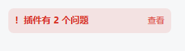
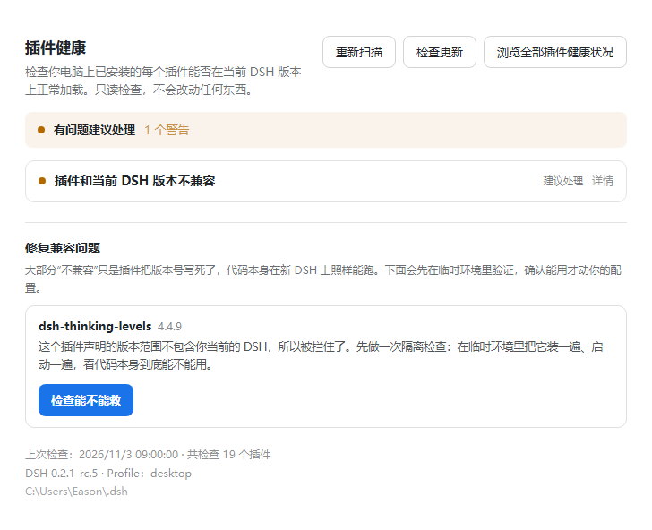
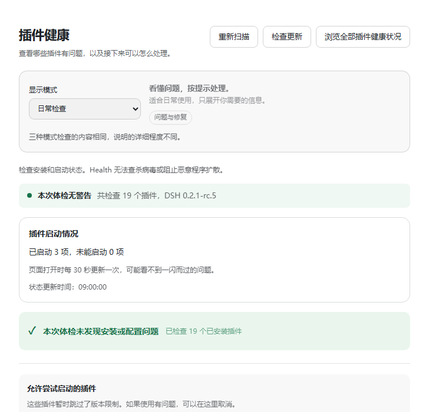

# dsh-plugin-health

[](https://github.com/EasonMWS/dsh-plugin-health/actions/workflows/ci.yml)
[](https://www.npmjs.com/package/dsh-plugin-health)
[](LICENSE)

[English](https://github.com/EasonMWS/dsh-plugin-health/blob/main/README.md) · [中文](https://github.com/EasonMWS/dsh-plugin-health/blob/main/docs/README.zh.md)

**DSH 更新完，插件突然不加载了？这个工具告诉你哪个坏了、哪个能救、哪个救不了——然后帮你修。**

有些插件被拒绝，是因为版本声明尚未更新。对于你已经信任的插件，这个工具可以使用单独的
临时 DSH 数据目录试装和启动，再提供版本放行、交给你自己 AI 的说明，或禁用插件的配置入口。

**Health 检查兼容性和观测到的加载问题，不能阻断恶意软件扩散。** 启动检查会以当前账号权限
执行插件代码，不能用来安全试跑未知软件。详见 [Health 能力边界](../SECURITY.md#malware-containment-is-not-implemented)
及 [DSH 官方安全说明](https://github.com/deepseek-ai/deepseek-harness/blob/master/SAFETY.md)。

> 源码候选版：`3.2.0`。下方的 npm 安装命令使用已发布的版本。索引由官方发布的
> `@deepseek-ai/dsh-plugin-market-index` 校验器验证。

```sh
npm install -g dsh-plugin-health
```

**不用碰命令行也能用**：装好后重启 DSH，点左下角 **设置 → 插件健康**，
界面上点按钮就行。下面的命令只是给习惯终端的人参考。

**还没打算装？** 先在浏览器里查：
**<https://easonmws.github.io/dsh-plugin-health/compat/>** —— 已收录的每个插件对每个当前宿主版本，每日重建。

---

## 目录

| 你是… | 看这里 |
| --- | --- |
| DSH 用户，插件坏了 | [修复一个坏插件](#修复一个坏插件) |
| DSH 完全起不来 | [DSH 起不来的时候](#dsh-起不来的时候) |
| 插件作者 | [在 CI 里检查兼容性](#插件作者在每个-pr-上自动检查兼容性) |
| 要做插件市场 | [把插件索引当数据源](#把插件索引当数据源用) |
| 想确认这工具安不安全 | [安全](#安全) |

---

## 修复一个坏插件

插件被拒时，侧栏会直接冒一个提示，不用自己去找：



打开 **设置 → 插件健康**。每个问题一行，每个插件一个按钮：

- **检查能不能救** —— 使用单独的临时 DSH 数据目录试装、启动可信插件（30~60 秒）。
  这一步不会向你的正常 profile 写入任何东西；被执行的插件仍可访问当前账号有权限的文件、网络和进程。
- **能启动** → *临时放行*。往宿主自己的 `compatibility.json` 写一条记录，一键可撤销。
- **起不来** → 不提供放行按钮。给两个选择：关掉这个插件，或者拿一份提示词交给你的 AI。

Health 的放行记录可以撤销。撤销不会逆转插件执行已经造成的影响。



预演通过后才会写入放行，旁边就是撤销按钮：



**一次看全部插件。** 如果你更习惯终端：

```
$ dsh-plugin-health doctor --profile desktop
扫描 19 个插件…
✓ 14 个正常
⚠ 3 个声明的版本范围过时（可以救）
✗ 2 个真的不兼容
```

## 临时放行到底是什么意思

**门禁放行，不等于官方支持。** 通过表示本次临时 DSH 数据目录中的启动检查完成；
不代表插件安全，也不代表所有功能正常。

- 写的是 DSH 官方的 `allow-version` 豁免，不是改插件、不是改 npm 上的包
- 只对你当前这个 DSH 版本生效，升级后需要重新判断
- 「临时放行记录」里可以撤销并恢复记录中的原豁免值，不会逆转插件对文件、网络等产生的影响
- 作者发布正式支持版本后，这里会提示你可以撤销并升级

## 从"被拒绝"到"修好"之间做了什么：四个层次

读声明是第一层。从一个插件被拒绝，到你的 DSH 恢复正常，中间有四件事：

| # | 层次 | 做什么 | 在哪跑 |
| --- | --- | --- | --- |
| **1** | **检测** | 扫每个已安装插件（bundles、`dependencies`、`cordis.patch.yml` 的 insert 含嵌套、`node_modules`），把声明和你实际运行的版本对比 | 你的机器 |
| **2** | **验证** | 用**单独的临时 DSH 数据目录**试跑可信插件：在该目录放行、安装、启动，检查激活状态 | 当前账号权限；保留试跑文件 |
| **3** | **修复** | 预演能启动，才往**你的** profile 写一条官方 `allow-version` 豁免——有记录，一键撤销 | 你的 profile |
| **4** | **兜底** | 试跑失败或未得出结论，就不向正常 profile 写放行记录，提供禁用配置入口或给 AI 的说明。上报前先查上游有没有人报过 | 你决定 |

**第 2 层是起决定作用的那一层。** 没有它，第 3 层就是在赌。

## 第 1 层除了版本声明，还看什么

版本不兼容是最响、最好解释的一种失效，但它很少是一个装了又卸了大半年的 profile 里唯一的问题。
第 1 层读的是整份配置，不只是版本范围：

| 能发现什么 | 为什么重要 |
| --- | --- |
| **重复的插入 id** | 两个插件注册了同一个条目 id。后一个会静默顶掉前一个，被顶掉的那个插件看起来毫无理由地坏掉 |
| **模块替换** | 一个插件的 patch 移除或替换了另一个插件提供的模块 |
| **后层丢掉的字段** | `home` 或 `profile` 里的 patch 覆盖了某个 bundle 设的字段，于是那个 bundle 的行为变了，而版本号一个都没动 |
| **profile 里的宿主核心包** | 宿主本来就自带的包的一份副本，可能遮蔽宿主自己的那份 |
| **共享写声明重叠** | 两个插件声明写同一个路径 |

最后一条故意叫**重叠**，不叫**冲突**。两个插件声明写同一个文件，是风险的证据，不是它们真的抢过的证明
——其中一个可能根本不会运行，也可能写的是不同的键。报告只说明哪些声明重叠、各自来自哪一层，然后停在这里。
怎么处理取决于你的环境，工具没有这个判断。

## 只在一起出问题的插件

一个插件单独启动可能干干净净，但和邻居一起装进去就坏——它们要同一个工具名，或者其中一个依赖了
另一个替换掉的服务。只试一个插件的检查看不到这种情况。

`smoke` 支持重复写 `--with <spec>`，最多十二个：

```sh
dsh-plugin-health smoke --dsh-dir <已安装的 @deepseek-ai/dsh> \
  --plugin @scope/plugin-a@1.4.0 --boot-only \
  --with @scope/plugin-b@2.0.1 \
  --with @scope/plugin-c@0.9.0
```

检查要求每个指定的包**真的在 Loader 里到达 `active`**。仅仅是同名的一个条目不算数——那正是要抓的失效模式：
有东西注册了，所以浅层检查报成功，而你要问的那个插件根本没加载。

这仍然是一个数据目录，不是沙箱。见「安全边界」一节。

## 插件作者：在每个 PR 上自动检查兼容性

**你不用装任何东西。** DSH 每一两周发一个预发布版，写死的 `engines.dsh` 就会定时把你的插件搞挂。
这个 Action 会在 PR 里告诉你会不会挂——在用户发现之前。

加一个文件 `.github/workflows/dsh-compat.yml`：

```yaml
name: dsh compatibility
on: [pull_request]
permissions:
  contents: read
  pull-requests: write      # 评论 PR 需要这个权限
jobs:
  matrix:
    runs-on: ubuntu-latest
    steps:
      - uses: actions/checkout@v4
      - uses: EasonMWS/dsh-plugin-health@v3
        with:
          plugins: .
          versions: latest,next
```

它会在 PR 下评论一张兼容性表，并输出 `matrix.json`、`matrix.md` 和 SVG 徽章。

**挂了就让构建失败。** 加 `failOn: any`，不兼容时 job 直接红。更稳的做法是只盯你要支持的版本：

```yaml
        with:
          plugins: .
          versions: latest,next,alpha
          failOn: next          # 只在 next 通道上失败
```

**把结果贴进 README。** 运行会生成可直接提交的徽章：

```markdown

```

这是回答「这东西在当前 DSH 上还能用吗」最省事的方式——对你、对随便点进你仓库的人都一样。

**或者用实时徽章，什么都不用提交。** 公开兼容页为目录里每个插件都发布了一个
[shields.io endpoint](https://shields.io/badges/endpoint-badge)，每天对着最新宿主重建。把 `<slug>` 换成你的包名
（`@scope/name` 写成 `scope__name`）：

```markdown
[](https://easonmws.github.io/dsh-plugin-health/compat/#p-<slug>)
```

它只说成立的最强结论，不多说：只有这个确切版本在最新宿主上实测启动过才显示 `boots`；只查了声明就是
`accepted`；你的声明会拒绝下一个预发布版时显示 `next build rejects`；声明过时但代码能启动时显示
`rejected · boots if exempted`。同样的数据在 `compat/p/<slug>.json`。

完整参数见 [`action.yml`](action.yml) · 例子见 [`examples/dsh-compat.yml`](examples/dsh-compat.yml)。

## 为什么中间这层重要

版本声明过时，并不能告诉我们插件能否启动。`0.2.1-rc.4` 实测：

| 插件 | 声明状态 | 临时 DSH 数据目录中的启动结果 |
| --- | --- | --- |
| `@nanmicoder/dsh-agent-teams@0.1.27` | ❌ 被拒 | ✅ **完整启动，94 个 entry 全部激活** |
| `dsh-find-plugin@0.4.0` | ❌ 被拒 | ✅ **真的能跑** |
| `@feng0531/dsh-vcs@0.4.10` | ❌ 被拒 | ❌ **失败：在等宿主已不再提供的服务** |

按声明看，三个被拒的理由完全一样。其中两个能正常启动，一个不能。
**读声明分不出它们的区别，所以先试跑再向正常 profile 写放行记录。** 放行第三个，恰好制造出门禁想避免的结果——
一个能加载、但会出问题的插件，而且再没有任何警告留着。

## 所以我们做的是“先验证，再动手”

```
扫描发现插件被拒
  ↓
使用临时 DSH 数据目录放行并启动一次可信代码
  ├─ 起来了 → 本次独立启动检查通过
  │    → 在你的 profile 里放行（可一键撤销）
  │    → 记录状态，盯上游有没有发新版
  └─ 失败或未得出结论 → 说明本次检查观测到的结果
       → 不向正常 profile 写放行记录
       → 需要的话，帮你准备好给 AI 的完整上下文
```

这个顺序避免在启动检查通过前就向正常 profile 写放行记录，但不会限制被测代码访问电脑，
也不能让未知插件变得可以安全执行。

## 在设置页里长这样

安装后在 **设置 → 插件健康** 里：

- 每个不兼容插件下方有「**检查能不能救**」按钮
- 点了会使用临时 DSH 数据目录试装、启动可信代码（30~60 秒），此时不写正常 profile 的放行记录
- 启动检查通过后出现「**临时放行**」按钮；失败或未得出结论时说明观测结果
- 放行过的插件会记录在案，等上游发版后提示你撤销放行并升级

放行写入宿主支持的豁免项。撤销会恢复记录中的原豁免值，不会逆转插件副作用，
也不保证已经加载的代码立即停止。

### 顶部三个按钮

| 按钮 | 作用 |
|---|---|
| **重新扫描** | 立刻重跑整个检查 |
| **检查更新** | 手动问一次 npm：**这个插件自己**有没有新版本 |
| **社区兼容表** | 查看社区目录条目的版本声明和启动实测。[公开兼容性表](https://easonmws.github.io/dsh-plugin-health/compat/) |

**更新可以在面板里一键装，不用开终端。** 检查完会出现「立即更新」按钮，它调用 profile 自己的包管理器
（pnpm profile 就用 pnpm，绝不往 pnpm 里塞 npm），装的是检查到的那个确切版本。装完它会说"需要重启"
而不是替你重启——文件变了，但运行中的宿主还是加载时的代码，替你重启会不问一声就结束你的会话。
失败时显示包管理器自己的报错，而不是一个退出码。

**打开 DSH 时会自动查一次自己的新版本，而且很安静。** 一个过期的体检工具比没有更糟——它一边告诉你插件要处理，一边漏掉了给自己修的更新。每次启动一次请求，最多每 6 小时一次，只有真的有新版本才提示，并附上完整升级命令。每次都弹一句“已是最新”只会把你训练成无视提示条，而真有更新时提示条就在那儿。

**查失败就记成失败**，不会写成“已是最新”：这两句话不一样，只有一句是真的。

**不想让体检工具联网？** 设 `DSH_PLUGIN_HEALTH_NO_UPDATE=1`，它就完全不发更新请求。面板上的「检查更新」按钮照样能用——那是你主动问的。

## 在线查兼容性

装之前先看一眼：

**<https://easonmws.github.io/dsh-plugin-health/compat/>**

兼容表取材于社区目录，把条目的版本声明和当前宿主版本对比。

| | |
| --- | --- |
| **数量** | 兼容表收录条目总数（含未知结果）、按宿主版本统计与下一版本预测 |
| **分类** | 用目录自己的分类，可以筛 |
| **发布日期** | 当前版本的发布时间——能看出作者还在不在维护 |
| **筛选** | 按名字、按分类，或只看被拒的 |
| **语言** | 中英文切换，会记住 |

打勾表示插件的声明范围包含对应宿主版本。启动实测有单独的结果和证据链接。
标为 **仅 GitHub** 的条目使用默认分支上可读取的包清单。

同一份数据可以下载：[`matrix.json`](https://easonmws.github.io/dsh-plugin-health/compat/matrix.json)。
也可以给自己的插件集生成一份：

```sh
dsh-plugin-health matrix --plugins list.txt \
  --versions latest,next \
  --catalog https://awesome-dsh-plugin.com/plugins.json \
  --out site/compat
```

## 把插件索引当数据源用

如果你在做插件市场、目录站、启动器，这里有一份现成的 format-1 索引：

```
https://easonmws.github.io/dsh-plugin-health/index.json
```

**在 DSH 里直接就能用：** 把这个 URL 粘到 **插件 → 自定义插件市场 → 发现 → 添加索引源**。

- **format-1** —— DSH 官方市场索引格式，每次构建都用 `@deepseek-ai/dsh-plugin-market-index`
  （DSH 宿主读索引用的同一个校验器）验过
- **300 个插件**，每天 UTC 04:23 重建
- 每个插件含：名称、描述（中英）、作者、仓库、主页、分类、下载量、GitHub stars、
  健康分、最近版本历史
- 数据来源：[`awesome-dsh-plugin.com/plugins.json`](https://awesome-dsh-plugin.com/plugins.json)

自己生成一份：

```sh
dsh-plugin-health index \
  --catalog https://awesome-dsh-plugin.com/plugins.json \
  --host "$(npm view @deepseek-ai/dsh version)" \
  --index-url https://example.com/index.json \
  --limit 300 --out site
```

细节：描述是中英双语的（`en` 必需，`zh` 保留）；分类来自目录，另有标签
（`npm`、`compatible`、`incompatible`、`unchecked`、`capability risk`）和排序键
（`downloads`、`stars`、健康分）。健康分是确定性算出来的——热度（下载量取对数 55、
stars 取对数 25），声明接受宿主 +10、被拒 −20，有能力红线 −10；用 `--verify` 提供了同一宿主上、
同一版本的启动实测时，`V3`（条目都激活了）+8，`V1`/`V2`（声明接受但装不上或起不来）−8。
没实测过的不加也不减。最后限制在 0–100。**它不是安全评级。**
下载量和 stars 来自 npm 与 GitHub 的公开数据。

范围：只收录已发布到 npm 的目录项（2026 年 10 月快照里 5,704 个中的 2,607 个）；
只在 GitHub 或 tarball 上的会被跳过并在报告里计数。

## 安全

**还在用 1.x / 2.x？请使用最新的 3.x。** 三轮审查修掉了一串问题，下面按版本列清楚：

| 版本 | 修了什么 |
|---|---|
| **1.1.0** | 安全测试在 1.0.2 里发现的 7 个问题，其中一个评为 high：写路由的控制密钥被无鉴权的 status 接口下发了 |
| **2.0.0** | 两轮审查的 25 个发现。跨源页面能驱动全部写路由（cookie 不区分端口，同站不等于同源）；请求体可以指定安装并运行任意包；三条路径能在没对目标宿主做过预演的情况下授予豁免 |
| **2.1.1** | 上一版**没修住**的四处。其中一处是回环校验只看 `Host` 头——那个头由客户端写，所以宿主绑局域网地址时，**局域网内任意机器**都能发 `Host: 127.0.0.1:<port>` 通过全部检查，从 `/status` 拿到密钥，然后禁用任意插件 |
| **2.1.3** | 界面拿不到密钥导致所有按钮 401；顺带修了把认证失败说成网络失败的文案 |

**如果你把 DSH 的 web 服务器绑到非回环地址**（`0.0.0.0` 或某个局域网 IP），请把每个插件路由都当作暴露在网络上，并确认你依赖的是宿主自己的鉴权。

- [GHSA-vj8q-543v-9hw5](https://github.com/EasonMWS/dsh-plugin-health/security/advisories/GHSA-vj8q-543v-9hw5) — 1.1.0
- [GHSA-52w2-cq6j-xhg7](https://github.com/EasonMWS/dsh-plugin-health/security/advisories/GHSA-52w2-cq6j-xhg7) — 2.0.0
- [SECURITY.md](SECURITY.md) — 信任边界写在这里

**信任边界，直说：** 写路由对**任何本地进程**可达。真正的边界是 loopback 接口，不是那个密钥——同机进程读得到 `Set-Cookie`，密钥挡不住它。密钥挡的是「别的端口的页面」，那由 peer 校验 + 同源校验负责。

## 安全边界（请务必读一遍）


| Health 自身做什么 | Health 自身不做什么 |
| --- | --- |
| 使用临时 DSH 数据目录试装、启动可信代码 | ❌ 不自动调用你的 AI，不花你的 token |
| 使用 DSH 官方 `allow-version` 豁免机制 | ❌ 不修改插件源码，不改 npm 上的包 |
| 记录版本放行并支持撤销这些记录 | ❌ 验证失败时绝不放行 |
| 帮你检查上游是否已有人报过 issue | ❌ 不替你提交 issue |
| 准备好完整的 AI 上下文包 | ❌ 不替你按下发送键 |

以上描述的是 Health 自身的操作，被试跑的代码仍拥有当前账号权限，不受这些承诺约束。
检查失败时，插件也可能已经产生副作用。修复所说的「隔离区」是普通备份目录，不是杀毒隔离。

**临时放行允许插件在指定宿主版本加载。** 试跑覆盖观测到的启动检查，不涵盖恶意行为或所有功能。
等作者发布正式支持版本后，请撤销放行并升级。撤销许可不会逆转插件已经造成的影响。

## 3.x 承诺什么

大版本号是对稳定性的承诺，所以这里把**冻结的**和**还没冻结的**都说清楚，而不是让你升级时才发现。

2.0.0 故意破坏了三件事，都写在 CHANGELOG 里：写请求必须带 `application/json`、救援动作拒绝未安装的插件、解析不了的 `compatibility.json` 会被拒绝重写而不是覆盖。下面这些从 1.0 起就一直成立，现在依然成立。

**3.x 保持稳定的接口：**

| 面 | 保证 |
| --- | --- |
| CLI 命令与参数（`matrix`、`smoke`、`doctor`、`repair`、`rescue`、`handoff`、`report`、`boot`、`index`） | 现有参数含义不变。可以新增参数，但不会删除或改变含义 |
| `plugin_health` agent 工具的名字与输入 schema | 只增字段，不改已有字段 |
| 退出码（`0` 成功 / `1` 有问题或失败 / `2` 用法错误） | 不变 |
| 本工具写出的文件（`compatibility.json`、`plugin-health-rescue.json`、交接包） | 格式有文档且向前兼容：不认识的键会保留，不丢弃 |
| 状态路由结构（`/plugins/dsh-plugin-health/status`） | 只增字段，已有字段名与类型不变。自 2.1.3 起 body 里多了 `key`——面板用它给自己的写请求做鉴权，为什么这不比 cookie 弱见[安全](#安全)一节 |

**未冻结**——可能在 minor 版本变化，因为它们属于展示层或内部实现：

- UI 文案、布局、配色、设置面板的结构；
- 生成的 AI 提示词和 issue 草稿里的建议措辞；
- `src/` 下的内部模块划分（除 `./api` 和 `./client` 两个导出，`src/` 不是公开导入路径）；
- 已文档化之外的 finding id——新增检查会带来新 id。

**宿主升级时的版本策略。** `engines.dsh` 写的是**范围**（`>=0.2.0-rc.0 <0.3.0-0`）而不是枚举，
所以新的 DSH nightly 不会像打断那些写死版本的插件那样打断本插件。等 DSH 0.3.0 发布时，
本包需要发一版扩展这个范围——**这是唯一已知的过期点**，会提前写进 changelog。

## DSH 起不来的时候

插件坏了导致 DSH 根本启动不了时，设置页自然也打不开——那些功能都跑在 DSH 里面。
所以这三个命令**完全独立于 DSH**，只要能开终端就能用：

```sh
# 1. 先看为什么起不来（读宿主留下的日志和静态检查）
dsh-plugin-health boot diagnose --profile desktop

# 2. 实在查不出，就先把所有第三方插件停掉，让 DSH 能启动
dsh-plugin-health boot safe --profile desktop --apply

# 3. 找到元凶、修好之后，恢复原状
dsh-plugin-health boot restore --profile desktop --apply
```

`boot safe` 只往 profile 自己的补丁层追加 `disabled: true`：
**不删文件、不动插件、宿主自带条目一律不碰**。`boot restore` 只移除它自己加的条目，
你自己的配置原样保留。两者默认都是 dry-run，加 `--apply` 才真正写。

## 你在找“插件管理器 / 插件检查 / 插件冲突检测”吗？

如果你在搜下面任何一个，那你要的就是这个：

| 你在找… | 这个包能做到 |
| --- | --- |
| DSH 的**插件管理器** | 一页看全所有已安装插件及状态 |
| **插件检查 / 体检 / 扫描**工具 | 扫描全部已安装插件，不是抽样 |
| **插件诊断 / doctor** | 说清哪里坏了、该怎么处理 |
| 插件升级与冲突预检 | 检查版本声明、可识别的配置覆盖和多个插件声明写入的同一文件 |
| 想**修复坏掉的插件** | 一键修复（只隔离不删除，随时可找回） |
| **DSH 更新后插件突然不能用了** | 对比插件声明与新宿主要求 |
| plugin manager / plugin doctor / plugin checker / plugin conflict | 英文界面同样支持 |

**不适合你**：如果你想“逛市场、发现并安装新插件”——那是插件市场的活，这个包管的是你已经装了什么。
（不过官方 format-1 索引正是由它生成的，市场可以消费。）

## 为什么需要它：升级后，DSH 只在 stderr 上留一行就把插件丢掉了

DSH 会拒绝**新安装**一个声明范围不匹配当前版本的插件：

```
$ dsh plugin --profile test add dsh-session-recall
dsh: installation rejected: Plugin dsh-session-recall@0.7.9 is incompatible with dsh 0.2.1-rc.3
dsh: nothing was installed.
```

它也会在每次启动 profile 时重新检查**已经装好**的插件。声明不再接受当前宿主的 bundle 会被跳过，
profile 的其余部分照常启动，就像什么都没发生。唯一的痕迹是 stderr 上的一行，桌面版不会显示：

```
dsh: skipping profile bundle "dsh-browser-cdp": Error: Plugin dsh-browser-cdp@1.7.5 is incompatible
with dsh 0.2.2-rc.1: requirements {"engines.dsh":"0.1.7-rc.1 || … || 0.2.1-rc.5"}. …
```

2026-11-09 核实：读了 `@deepseek-ai/dsh-app-boot` 从 `0.2.0-rc.2` 到 `0.2.2-rc.1` 的代码（检查在
`loadProfileDirectory` 里，来自 patch 层的条目由启动预检禁用），并实际启动了一个装有该插件的 profile：
有豁免时它注册了自己的工具；去掉豁免后 profile 正常启动，插件悄无声息地不见了。本 README 以前写的是
插件升级后「依旧加载」——那是错的。

所以，你依赖的插件可能在宿主更新后消失，界面上没有任何地方告诉你是哪个、为什么。这就是本工具要补的
缺口：读出每个已安装插件自己声明的范围，和你实际在跑的版本对比，告诉你宿主现在丢掉了哪些，并检查
每一个是否其实还能启动。

## 它已经抓到过真实问题

宿主每升一个版本，就对已收录的插件跑同一套扫描。新宿主会拒绝哪个插件，就给哪个插件的作者提一份报告：
哪条声明不通过、在哪个宿主版本上、官方评估器怎么判。作者不用安装任何东西就能复核。

截至 2026-11-09：**共提报 11 份，10 份已由作者修复并发布，1 份尚无回复。** 大部分在两天内关闭。

| 宿主 | 插件 | 报告 | 修复版本 |
| --- | --- | --- | --- |
| `0.2.1-rc.2` | `dsh-plugin-subscriptions` | [V1ki/dsh-plugin-subscriptions#158](https://github.com/V1ki/dsh-plugin-subscriptions/issues/158) | `0.9.10` |
| `0.2.1-rc.3` | `@anionex/dsh-vision-toolkit` | [Anionex/dsh-vision-toolkit#178](https://github.com/Anionex/dsh-vision-toolkit/issues/178) | `0.1.48` |
| `0.2.1-rc.3` | `@nanmicoder/dsh-agent-teams` | [NanmiCoder/dsh-agent-teams#277](https://github.com/NanmiCoder/dsh-agent-teams/issues/277) | `0.1.27` |
| `0.2.1-rc.3` | `@goodandready/dsh-clinebot` | [GooDAnDReaDY/dsh-clinebot#17](https://github.com/GooDAnDReaDY/dsh-clinebot/issues/17) | `0.6.16` |
| `0.2.1-rc.5` | `dsh-chat-manager` | [WSL043/dsh-chat-manager#35](https://github.com/WSL043/dsh-chat-manager/issues/35) | `1.5.21` |
| `0.2.1-rc.5` | `dsh-context-compression-improved` | [drscrewdriver/dsh-context-compression-improved#9](https://github.com/drscrewdriver/dsh-context-compression-improved/issues/9) | `0.10.3` |
| `0.2.1-rc.5` | `dsh-prime-memory` | [drscrewdriver/dsh-prime-memory#26](https://github.com/drscrewdriver/dsh-prime-memory/issues/26) | `0.26.16` |
| `0.2.1-rc.5` | `dsh-perm-gate` | [drscrewdriver/dsh-perm-gate#5](https://github.com/drscrewdriver/dsh-perm-gate/issues/5) | `5.4.1` |
| `0.2.1-rc.5` | `dsh-browser-cdp` | [drscrewdriver/dsh-browser-cdp#7](https://github.com/drscrewdriver/dsh-browser-cdp/issues/7) | `1.7.5` |
| `0.2.1-rc.5` | `dsh-thinking-levels` | [drscrewdriver/dsh-thinking-levels#7](https://github.com/drscrewdriver/dsh-thinking-levels/issues/7) | `4.4.10` |
| `0.2.1-rc.2` | `@feng0531/dsh-vcs` | [f-e-n-g-0531/dsh-vcs#1](https://github.com/f-e-n-g-0531/dsh-vcs/issues/1) | — 尚无回复 |

另有 `dsh-workbuddy-connect` 在 `0.2.1-rc.3` 上被拒，但仓库无法访问，报告提不了。

> 已用发布的 0.1.47 manifest 和官方 rc.3 宿主兼容性评估器复核确认：**19 个 DSH peer 被拒**，
> 而 rc.2 仍然通过。已在 #179 合入 main 修复……九个 PR CI 全部通过，其中**新增了必需的 rc.3 Profile 检查**。
>
> — [Anionex/dsh-vision-toolkit#178](https://github.com/Anionex/dsh-vision-toolkit/issues/178#issuecomment-6388178989)

范围怎么声明，由作者自己决定。有的只补上测过的那一个新版本；有两个改成了覆盖整条预发布线的范围
（`dsh-clinebot` 的 `0.6.16`、`dsh-plugin-subscriptions` 的 `0.9.12`），这条线再出预发布版时不会再被拒。

升级报告：[docs/upgrade-0.2.1.md](docs/upgrade-0.2.1.md) ·
[docs/upgrade-0.2.1-rc3.md](docs/upgrade-0.2.1-rc3.md)。
已收录于 [awesome-dsh-plugin](https://github.com/awesome-dsh-plugin/awesome-dsh-plugin) 和
[dsh-plugin.org](https://dsh-plugin.org)。

## 有 UI，但只在你需要时出现

把它作为 bundle 装进 profile，DSH 设置里会多出一个原生分区 **设置 → 插件健康**：

```sh
dsh plugin --profile desktop add dsh-plugin-health
#                 ^^^^^^^ 桌面版用 `desktop`；`dsh web` 用 `web`
```

- **安装扫描**显示在当前环境找到的包数，来源包括 bundle、依赖、补丁和插件目录，缺失或损坏的包也可能计入。
  **启动状态**数的是加载条目，一个包可以对应多个条目。
- 每条问题都用大白话解释，并给出「怎么做」，第一次用的人不用读文档也能处理；
- 顶部显示 **本次检查未发现问题** 或 **有问题建议处理**。用 **重新扫描** 再查一次，
  用 **检查更新** 查询 Health 自身的版本，或打开 **社区兼容表** 看公开目录条目。[公开兼容性表](https://easonmws.github.io/dsh-plugin-health/compat/)
- **打开 DSH 时会自己查一次新版本**，查到了才提示（附上完整的升级命令），没查到就什么都不说——
  不会每次开面板都弹一句"已是最新"；
- 侧栏在发现问题或 Health 有可用更新时显示入口。
- **真的有问题时**，账号菜单上方会出现一个 `插件有 N 个问题` 的小入口，点一下直接跳到设置分区；
- host 半身只提供 loopback 只读快照，不会修改你的 profile。

> **准备升级 DSH？先跑一遍体检。**
>
> `0.2.1-rc.3`（2026-10-23）让 Top 120 里的兼容数从 118 掉到 **113**：
> **5 个在 rc.2 上正常的插件，到 rc.3 就加载不了**，原因都是把 `@deepseek-ai/*` 版本写成了精确枚举。
> 截至 2026-10-26，其中 **4 个已修复发版**（受影响数 5 → 1）。
> 更早的 rc.2 也曾打崩另外 3 个。最新报告：
> [docs/upgrade-0.2.1-rc3.md](docs/upgrade-0.2.1-rc3.md) ·
> [docs/upgrade-0.2.1.md](docs/upgrade-0.2.1.md)。
>
> ```sh
> dsh-plugin-health matrix --plugins plugins.txt --versions 0.2.1-rc.2,0.2.1-rc.3
> ```

## 为什么做

DSH 没有官方插件市场索引；发行节奏约 **2.1 天一个版本**且带破坏性变更。官方插件管理器其实已经能
安装、列出版本、更新和授予版本豁免——但它只按**正在运行的那一个宿主**判断，作者要验证别的版本仍然
得自己一个个试，而且没有任何环节真的启动过插件。Windows/WSL 安装失败还会留下残缺目录和残留锁文件。
现有 doctor/市场工具也只验证本机当前安装的那个版本，不处理 Windows 文件锁和跨 profile 问题。

这个工具补三个缺口：

1. **多宿主兼容矩阵**：插件能不能在 `0.1.7-rc.2` / `0.2.0-rc.2` / `0.2.1-alpha.4` /
   `0.2.1-rc.2` 上加载？使用官方语义精确判定（`engines.dsh` 优先，否则检查
   `@deepseek-ai/dsh*` peers；预发布参与 range；`workspace:` 映射到宿主版本）。
2. **官方 format-1 市场索引**：把社区目录变成内置 **Discover** 能直接吃的 JSON 索引，并用
   DSH Host 同款解析器验证。
3. **Windows/WSL 安装诊断**：默认只读；修复动作只隔离不删除，改 patch 保留用户注释。

## 安装

```sh
npm install -g dsh-plugin-health
# 或首发前本地运行：
git clone https://github.com/EasonMWS/dsh-plugin-health.git && cd dsh-plugin-health && npm ci
node bin/dsh-plugin-health.js --help
```

需要 Node.js 20+。

### 作为 DSH bundle 安装（可选）

这个包同时是一个可安装的 DSH bundle。装进 profile 后会提供一个只读的 `plugin_health` agent
工具，报告：声明但未安装的第三方 bundle、残缺的包目录、`cordis.patch.yml` 残留、代理/registry
配置、profile 差异，以及已装插件与当前 DSH 版本的不兼容。

```sh
dsh plugin --profile desktop add dsh-plugin-health
#                 ^^^^^^^ 桌面版用 `desktop`；`dsh web` 用 `web`
```

bundle 声明了 `engines.dsh`，会同时注册这个只读工具和设置界面。
profile 修改由界面的修复、放行等明确操作触发；启动时还可按上文说明查询 Health 更新。

## 1. 兼容矩阵

```sh
dsh-plugin-health matrix \
  --plugins examples/plugins.txt \
  --versions latest,next,alpha,0.1.7-rc.2 \
  --out dsh-health-out/matrix \
  --fail-on any
```

- `--plugins`：文件（一行一个，支持 `#` 注释）、逗号列表，或重复参数；每项是 `name`、
  `name@version`，或本地插件目录。
- `--versions`：精确 SemVer，或 `@deepseek-ai/dsh` 的 npm dist-tag（`latest`/`next`/`alpha`）。
- 输出：`matrix.json`、`matrix.md`、静态 SVG 徽章（`badges/`）。
- `--fail-on any|none|<host>`：直接用作 CI 门禁。

判定规则与官方 `packages/boot/app-boot/src/plugin-compatibility.ts` 一致：

| 插件声明 | 检查 |
|---|---|
| `engines.dsh` | 只看这个 range，忽略 peers |
| 无 `engines.dsh`、有 peers | 所有 `@deepseek-ai/dsh` / `@deepseek-ai/dsh-*` peer range |
| peer 为 `workspace:^` / `~` / `*` | 视为当前宿主版本 |
| 宿主为预发布 | 参与 range 比较（`includePrerelease: true`） |

矩阵是**静态判定**（manifest + 官方兼容规则）。声明兼容不代表插件已激活、工具能执行；
可以用下面独立、显式执行的 `smoke` 命令补充运行时验收。Git 插件仍可从本地目录做静态检查。

### 在全新 profile 中做运行时验收

先把目标宿主版本安装到独立目录，再验收用户实际安装的包，包括发布用的 tarball：

```sh
npm install --prefix /tmp/dsh-rc3 @deepseek-ai/dsh@0.2.1-rc.3
dsh-plugin-health smoke \
  --dsh-dir /tmp/dsh-rc3/node_modules/@deepseek-ai/dsh \
  --plugin ./my-plugin-1.0.0.tgz \
  --tool my_plugin_tool \
  --calls ./smoke-calls.json \
  --out dsh-health-out/runtime
```

`smoke-calls.json` 是工具调用数组。调用必须成功；提供 `expectedValue` 时还会精确比较完整的
结构化返回值：

```json
[{"name":"my_plugin_tool","arguments":{"input":"example"},"expectedValue":{"answer":42}}]
```

命令使用全新的 `DSH_HOME`，通过官方 `dsh plugin` CLI 安装，经宿主公开的
`@deepseek-ai/dsh/profile-boot` 启动，然后检查工具注册、执行调用、释放 profile。
至少提供一个 `--tool` 或 `--calls` 断言。只有 `--tool` 时仅检查注册，不代表功能或浏览器 UI
已经验收。每个宿主版本分别运行一次。

安装默认最多 120 秒，启动、调用与退出合计最多 30 秒，可用 `--install-timeout`、`--timeout`
调整（毫秒）。超时会尝试停止试跑的子进程树，清理只能尽力完成。报告保留失败阶段
（`install`、`boot`、`assertions`、`shutdown`）与宿主错误，即使超时后的信号处理以 0 退出，
这次验收仍然失败。
POSIX 下，父进程以 0 退出却留下后台子进程时，同样判定失败并停止其进程组。Windows 超时
使用 `taskkill /T`；目前不能在父进程已经退出后检测其遗留子进程。

**被测插件默认继承你的环境变量。** 这是为「试跑自己的插件」写的：那是你的代码，用你的权限运行。
但如果这个插件你没读过——批量验证、CI 跑一个目录里的插件——加 `--clean-env`，只有一份固定清单能穿过边界：
机器基础变量（`PATH`、`HOME`、`TMPDIR`、语言环境、`TZ`、`CI`，以及 Windows 上对应的那些）、
包管理器需要的（`HTTP_PROXY`、`HTTPS_PROXY`、`NO_PROXY`、`NODE_EXTRA_CA_CERTS`、`npm_config_*`、
`PNPM_HOME`、XDG 目录），以及 `DSH_HOME`。名字看起来像凭证的一律不传，即使在白名单里也一样；CI 注入的
`ACTIONS_*`、`GITHUB_*`、`RUNNER_*` 也从不传递。报告里记录 `env: { mode, passed }`——只有变量名，
没有值。

代理地址里如果带用户名密码，仍然会传过去，否则装不上包。`--clean-env` 是收窄插件能看到的东西，
不是沙箱。

每次运行都保留独立目录中的 home、`smoke.json`、`runtime.json` 与有长度上限的输出日志，
Health 将这个新目录选作试跑 profile，但不会限制被测代码访问现有 profile。目录不会自动清理，
分享前请检查日志。目标宿主需要自己的 Node.js、pnpm
运行要求，并需导出 `profile-boot`（已在 `0.2.1-rc.2`、`0.2.1-rc.3` 验证）。

**此命令会以当前系统账号权限、继承启动进程环境来执行插件代码。** 临时 DSH home 仅选择单独的
测试数据目录，不限制文件、网络或进程访问。只测试可信代码。未知软件需要另行配置文件、凭据、
网络和进程权限受限制的环境，Health 不会创建或验证这样的环境。启动检查不保证所有行为安全、
所有功能正常或 UI 兼容。

### 一次验证多个插件

`verify` 对一批插件做只测启动的 smoke，**始终**使用 `--clean-env`，并给每个插件一个等级：

| 等级 | 含义 |
| --- | --- |
| `V1` | 声明的版本范围接受这个宿主（与安装闸门同一套判定） |
| `V2` | 官方 CLI 能把它装进一个干净的 profile |
| `V3` | 启动后，这个插件的每个条目都处于激活状态 |

```sh
dsh-plugin-health verify --dsh-dir <已安装的 @deepseek-ai/dsh> \
  --plugins plugins.txt --out verify-out [--cache .verify-cache] [--shard 3/10] [--concurrency 2]
```

声明不接受当前宿主的插件，仍会在一次性 home 里带精确版本豁免跑一次，结果记在 `bypass` 下，
**不提升等级**："声明过时但代码能启动"和"代码坏了"是两种不同的结论，页面上会分开显示。

每个插件的占用（条目和工具名）都和同一宿主上的空 profile 对比，只列出插件新增的部分。
两个插件新增了同一个工具名或条目 id，会记入 `conflicts`，并标注为**预测**——它们并没有被装在一起跑过。

输出：`verify.json`（等级、失败原因、冲突预测）和 `results/<slug>.json`（完整 smoke 报告，含包校验值、
工具和运行环境版本、各阶段耗时）。`--cache` 对同一份包、同一宿主、同一工具版本线复用结果。
跑完即返回 `0`；`--fail-on any` 时有插件没到 `V3` 返回 `1`。

`V3` 的意思是插件启动了。它不是对代码行为的审查，也不覆盖需要 API key 的功能、桌面版或界面是否正常。

### 实跑示例（2026-10-17，7 个插件 × 4 个宿主版本）

```
dsh 0.1.7-rc.2: 6/7 compatible, 1 incompatible
dsh 0.2.0-rc.2: 5/7 compatible, 2 incompatible
dsh 0.2.1-alpha.4: 5/7 compatible, 2 incompatible
dsh 0.2.1-rc.2: 5/7 compatible, 2 incompatible
✗ dsh-win32@0.17.14：四个宿主全不兼容（@deepseek-ai/dsh-subprocess-local 的 peer 上界过窄）
✗ dsh-find-plugin@0.4.0：从 0.2.0-rc.2 起不兼容（@deepseek-ai/dsh-tools peer）
```

第一条正好复现了 dsh-win32 issue #89（peer 上界过窄导致新宿主线被拒绝）的真实问题，而且
不需要安装任何东西。

### GitHub Action：每个 PR 自动贴兼容矩阵

仓库内置可复用 workflow。把 [`examples/dsh-compat.yml`](examples/dsh-compat.yml) 放进插件仓库的
`.github/workflows/dsh-compat.yml`，之后每个 PR 都会收到一条兼容矩阵评论 + job summary，并且
矩阵产物会自动上传为 artifact：

```yaml
name: dsh plugin compatibility
on: pull_request
permissions:
  contents: read
  pull-requests: write
jobs:
  matrix:
    uses: EasonMWS/dsh-plugin-health/.github/workflows/matrix-review.yml@v3
    with:
      plugins: '.'
      versions: 'latest,next,alpha'
      comment: true
```

## 2. Windows/WSL 诊断与修复

```sh
dsh-plugin-health doctor --home C:\Users\me\.dsh --profile desktop --runtime 0.2.1-rc.2
dsh-plugin-health repair --home C:\Users\me\.dsh --profile desktop --apply --yes
```

检查项：profile 声明但未安装的第三方 bundle（DSH 安装自带的 `@deepseek-ai/*` 视为已提供）、
不可读/残缺的包目录、缺失的 profile 依赖、损坏或空的 `cordis.patch.yml` 条目、
`.bak-*` / `.lock` / `.lock.takeover-*` 残留、过大的插件管理器日志、WSL 与 Windows 长路径、
按 `--runtime` 检查已装插件是否兼容、以及 desktop/web 等 profile 之间的插件集差异。

修复必须显式 `--apply`，默认 dry-run，且**只隔离不删除**：

- 文件和目录移到 `<home>/.plugin-health/quarantine/<时间戳>/`，`repair-log.json` 记录每一步；
- `cordis.patch.yml` 只做文本级删除（顶层 `- []` 条目），先备份，保留用户注释与格式。

## 修改前先预检

在 **设置 → 插件健康** 用标题旁的按钮切换视图。**日常检查**提供问题摘要和修复入口，
**进阶诊断**增加加载条目、近期变化和配置覆盖，**开发验证**增加运行证据下载和命令行示例。
升级预检显示已判定版本声明的包数，以及声明不匹配且未放行的包数。

用 Tab 聚焦模式按钮，按 Enter 或空格切换。切换时保留预检输入、结果和展开状态。
将鼠标悬停在 **重新扫描** 上或用键盘聚焦按钮，可查看刷新频率和最近读取启动状态的时间。
安全能力边界写在页脚。刷新失败时保留上次结果并标记为过期，重新扫描成功后恢复正常结论。
配置发生变化后，已有预检结果会提示重新验证。导出前请留意其中的插件名、配置标识和路径。
只读请求超过 15 秒会退出等待并允许重试。修复确认绑定五分钟内生成的单次预览，
新增目标或检测到目标变化时需重新预览；失败后可查看原因并重新生成计划。

面板或侧栏刷新时会读取当前宿主加载器，最多保留本次启动期间观测到的 24 条状态变化。
如果宿主保留了可识别的工具重名错误，页面会显示工具名和被拒绝的条目。
动态观察覆盖插件的激活状态，工具调用、文件写入和网络行为需要单独实测。

进阶诊断可以下载当前配置快照。DSH 无法启动时也可以在终端比较快照。

```sh
dsh-plugin-health review --profile desktop --runtime 0.2.1-rc.5 --save before.json
dsh-plugin-health review --profile desktop --target 0.2.1-rc.6 --candidate ./unpacked-plugin --json
dsh-plugin-health review --profile desktop --runtime 0.2.1-rc.6 --compare before.json
```

`--candidate` 只读取本地解包目录，在预检中按现有位置或在 bundle 列表末尾模拟其配置层。
报告区分版本声明与加载状态，展示可识别的重复插入、后层省略的配置字段和部分宿主核心包副本。
动态配置、启动参数传入的覆盖层、实际工具和文件行为仍需验证。
快照保存包元数据和文件指纹，用于比对。修复备份独立保存。
已知版本声明不匹配或命令失败时返回状态码 1，适合在发布检查中保存 JSON 证据。

需要实测多个可信插件时，可在
`smoke --dsh-dir <dir> --plugin <包名@版本或解包目录> --boot-only` 中重复添加
`--with <包名@版本或解包目录>`，也可沿用工具断言。试跑会把指定的包安装在同一临时配置里，
检查它们是否进入加载器并激活，并逐一记录安装结果。试跑使用当前系统账号权限。

开发者可以在 `package.json` 自愿声明文件访问：

```json
{
  "dshPluginHealth": {
    "version": 1,
    "resources": [
      { "scope": "workspace", "path": "archive/index.json", "access": "write" }
    ]
  }
}
```

`scope` 可用 `workspace`、`profile` 或 `dsh-home`，`path` 为相对文件名，
`access` 为 `read` 或 `write`。多个包声明写入同一作用域的同一文件时会列出重叠证据。
实际并发写入和锁行为需另行验证。

新版在默认备份目录执行清理时会提供修复编号。
`dsh-plugin-health repair --restore <run-id>` 可预览恢复，添加 `--apply --yes` 后恢复符合条件的项。
原位置被占用或配置在修复之后已被编辑时，工具会保留现有内容并提示原因。
恢复后请启动 DSH 验证相关功能。

## 已经做完的事

这一节之前列的都是“计划”，现在全部在包里：

| 能力 | 怎么用 |
| --- | --- |
| 只有界面的插件也能验收 | `smoke --boot-only` 只要求激活，不探测 agent 工具 |
| 支持 git 和 tarball 来源 | `smoke --plugin <spec|tarball>` |
| 全 catalog 的矩阵，每夜构建 | `.github/workflows/publish-index.yml`，与索引一起发布 |
| 面板里直接看矩阵和 doctor 结果 | 设置 → 插件健康，三种显示模式 |
| 可复用的 GitHub Action 和公开看板 | `action.yml`，以及[兼容性页面](https://easonmws.github.io/dsh-plugin-health/compat/) |

## 开发

```sh
npm ci
npm test
```

可使用 `scripts/browser-qa.mjs` 验证真实 React 组件在 Edge 中的三种模式、展开动画、
键盘操作、360px 布局和深色显示。测试依赖安装方法在脚本开头，独立于发布包。
这项验证使用合成宿主数据，DSH 桌面内的实际布局仍需另行验收。

另外可针对已安装的宿主执行真实 tarball 验收（需要 pnpm）：

```sh
npm run test:runtime -- /tmp/dsh-rc3/node_modules/@deepseek-ai/dsh
```

会打包并安装正常、等待缺失服务、初始化抛错、初始化挂起四类受控插件，保留 profile 与报告。

单元测试覆盖官方兼容语义、format-1 构建（用官方解析器验证）以及基于 fixture home 的
诊断/修复流程，不依赖网络。

## 免责声明

DSH 插件以用户完整权限运行。健康分、兼容标签、目录收录都**不是**安全审计。第三方索引未签名，
只添加你信任的来源。

## License

MIT
